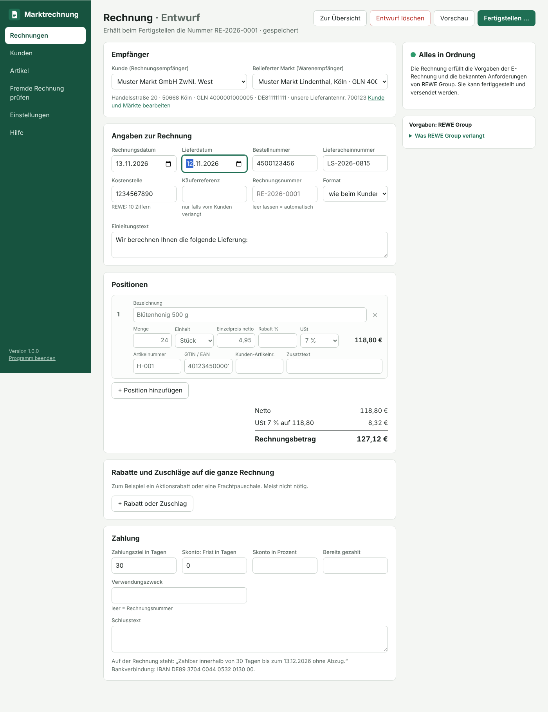
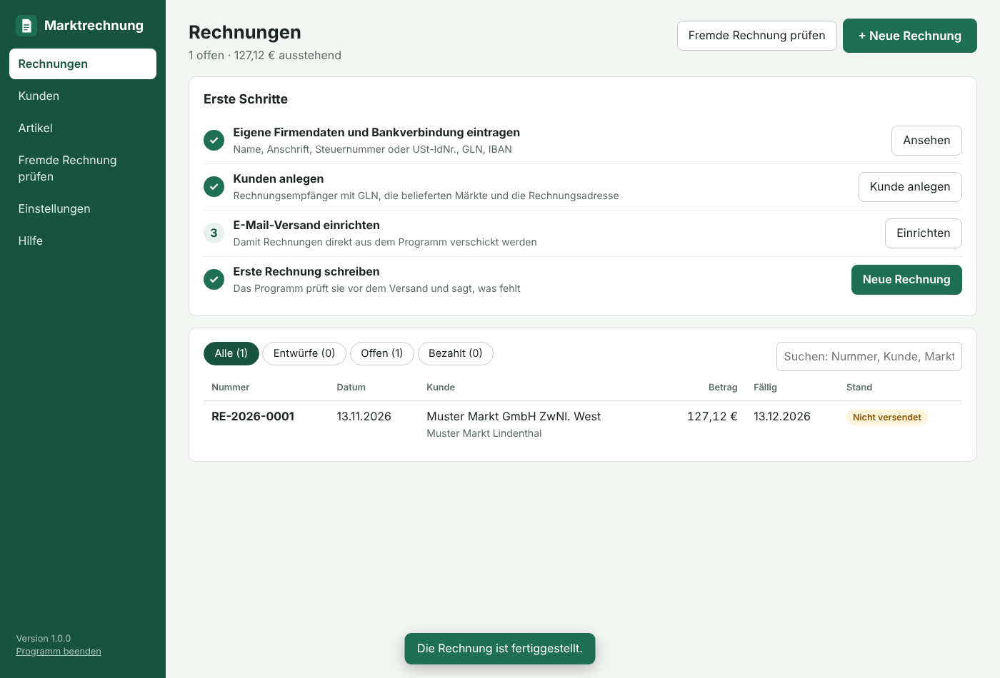
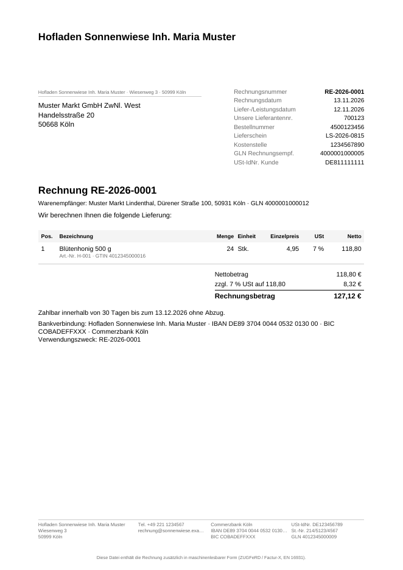
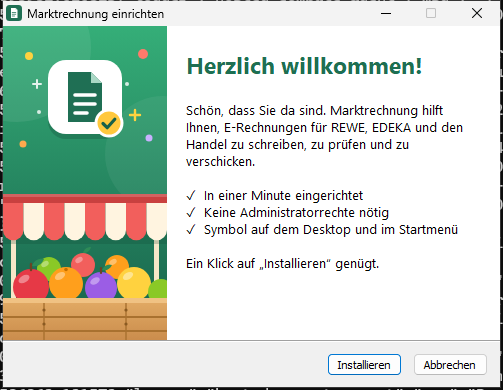
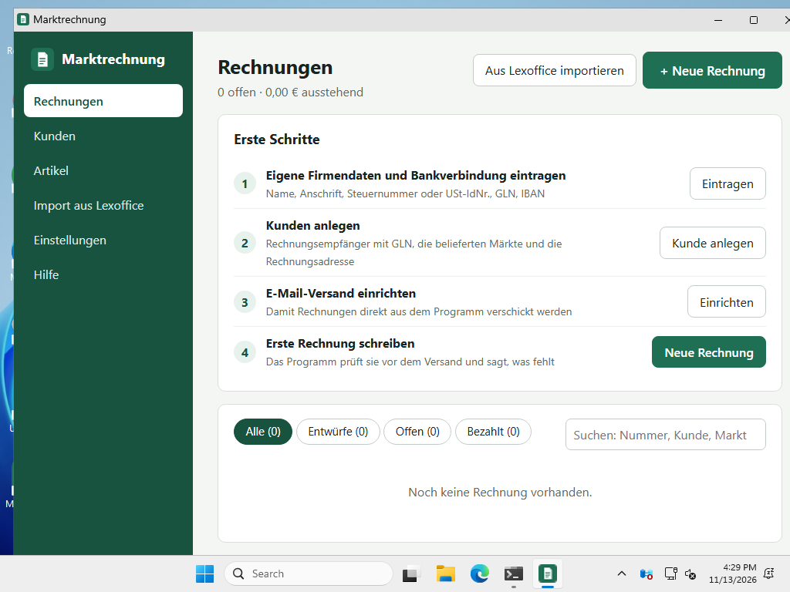
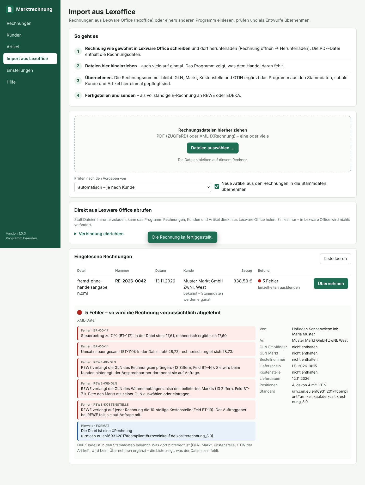

# Marktrechnung

E-Rechnungen für Lieferanten des Lebensmittelhandels: **erstellen, prüfen und
verschicken** – mit den Angaben, die REWE, EDEKA und andere Händler über das
gesetzliche Minimum hinaus verlangen.

Das Programm läuft auf dem eigenen Rechner (Windows, macOS, Linux). Es braucht
keine Installation, kein Konto und keine Internetverbindung außer zum eigenen
E-Mail-Postfach. Alle Daten bleiben als lesbare Dateien auf dem Rechner.



| Übersicht | Erzeugte Rechnung (ZUGFeRD-PDF) |
|---|---|
|  |  |

## Wofür es gedacht ist

Wer an den Handel liefert und seine Rechnungen bisher mit einem allgemeinen
Rechnungsprogramm wie Lexware Office (lexoffice) schreibt, bekommt sie oft
zurück. Meist ist nicht die Datei fehlerhaft – dem Handel fehlen Angaben für
seine automatische Verarbeitung:

| Angabe | Feld der Norm | Wer sie verlangt |
|---|---|---|
| GLN des Rechnungsempfängers | BT-46 | REWE, EDEKA, Handel allgemein |
| Warenempfänger (Markt) mit GLN und Anschrift | BT-71, BG-15 | REWE, EDEKA, Handel allgemein |
| USt-IdNr. des Rechnungsempfängers | BT-48 | REWE |
| Eigene GLN als Lieferant | BT-29 | REWE, EDEKA |
| Lieferscheinnummer, Bestellnummer | BT-16, BT-13 | REWE, EDEKA, Handel allgemein |
| Lieferdatum | BT-72 | alle |
| GTIN (EAN) oder Artikelnummer je Position | BT-157, BT-155 | REWE, EDEKA, Handel allgemein |
| Hinweis auf die Konditionsvereinbarungen | BT-22 (AAK) | REWE |

In Lexware Office stehen solche Angaben oft nur in der Anschrift („GLN: …“)
oder im Freitext – dort findet sie die automatische Verarbeitung des Handels
nicht. Marktrechnung führt sie als eigene Felder, liest sie beim Import aus
dem Text heraus, prüft Prüfziffern und Pflichtangaben **vor** dem Versand und
sagt in einfachen Worten, was fehlt.

## Was das Programm kann

- **Rechnungen schreiben** mit Kunden, Märkten und Artikeln aus den Stammdaten;
  Rabatte, Zuschläge, Skonto, zwei Steuersätze, Kleinunternehmer (§ 19 UStG)
- **Laufende Prüfung** gegen die Norm EN 16931, die deutschen XRechnung-Regeln
  und die Vorgaben von REWE, EDEKA und des Handels allgemein
- **E-Rechnung erzeugen** als
  - ZUGFeRD-PDF (PDF/A-3 mit eingebetteter XML, Profil EN 16931) – empfohlen
  - XRechnung 3.0 als reine XML-Datei (Syntax CII)
- **Versand per E-Mail** über das eigene Postfach, eine Rechnung je E-Mail,
  mit Vermerk, wann sie an wen ging
- **Import aus Lexware Office (lexoffice)**: Rechnungen als Datei oder direkt
  über die Schnittstelle einlesen, prüfen, aus den Stammdaten ergänzen und
  mit unveränderter Rechnungsnummer als vollständige E-Rechnung versenden
- **Zusatzfunktionen, einzeln einschaltbar**: Angebote, Lieferscheine,
  Serienrechnungen, Abschlagsrechnungen, offene Posten mit Mahnungen und eine
  Auswertung der Umsätze
- **Übergabe an DATEV**: Buchungsstapel im DATEV-Format für die Steuerkanzlei
  und Belegpaket für DATEV Unternehmen online (DATEV XML-Schnittstelle online)
- **Stammdaten prüfen**: ein Klick zeigt, wo bei Firma, Kunden, Märkten und
  Artikeln etwas fehlt oder nicht stimmen kann – unvollständige Anschriften,
  falsche Prüfziffern bei GLN, GTIN und IBAN, falsch geschriebene PLZ,
  USt-IdNr. und E-Mail-Adressen, doppelt vergebene GLN, Test-Postfächer
- **Stornieren** über eine Rechnungskorrektur; fertige Rechnungen sind nicht
  mehr änderbar
- **Anleitung und Assistent**: eine Schritt-für-Schritt-Anleitung im Programm
  und als bebildertes PDF; der Assistent (Taste F1) zeigt zu jeder Seite, was
  dort zu tun ist, führt durch die Einrichtung und beantwortet Fragen – ohne
  Internet aus der Anleitung, auf Wunsch zusätzlich mit KI
- **Rechnungsliste als CSV** für Buchhaltung und Steuerberatung, **Sicherung**
  des ganzen Datenordners als ZIP

## Einrichten

1. **Programm holen.** Unter *Actions → Marktrechnung* im GitHub-Repository
   liegt nach jedem Build das Paket für Windows, macOS und Linux; nach einer
   Veröffentlichung auch unter *Releases*.
2. **Einrichten und starten.**
   - **Windows:** `Marktrechnung-Setup-….exe` ausführen und auf
     *Installieren* klicken – mehr fragt der Assistent nicht. Das Setup braucht
     keine Administratorrechte, legt Symbole im Startmenü und auf dem Desktop
     an und trägt das Programm unter *Einstellungen → Apps* ein, wo es sich
     wieder entfernen lässt. (Ein anderer Zielordner: Aufruf mit `/D=Ordner`.)
     Beim ersten Start warnt Windows vor einem unbekannten Herausgeber, weil
     das Setup nicht signiert ist: *Weitere Informationen → Trotzdem
     ausführen*.

     

     Eine neue Fassung wird einfach darüber eingerichtet; Rechnungen und
     Daten bleiben erhalten. Wer nichts einrichten will, nimmt das
     Windows-ZIP und startet `Marktrechnung.exe` direkt.
   - **macOS:** ZIP entpacken, Rechtsklick auf `Marktrechnung` → *Öffnen*.
   - **Linux:** ZIP entpacken, `./marktrechnung` starten.

   Das Programm öffnet ein eigenes Fenster.
3. **Erste Schritte** auf der Startseite abarbeiten:
   - eigene Firmendaten, Steuernummer oder USt-IdNr., GLN, Bankverbindung
   - Kunden anlegen – für REWE und EDEKA gibt es Vorlagen
   - E-Mail-Versand einrichten und mit einer Probe-E-Mail testen
4. **Vor der ersten echten Rechnung** beim Kunden klären (siehe unten).

Wird das Fenster geschlossen, ist das Programm beendet; ein Doppelklick auf
das Symbol startet es wieder.



**Zum Fenster:** Unter Windows öffnet Marktrechnung ein eigenes Fenster wie
jedes andere Programm – mit eigenem Titel, Symbol und Rahmen, ohne Adresszeile,
Browsermenü oder Tastenkürzel eines Browsers. Rückfragen stellt das Programm
in eigenen Dialogen, Rechnungen öffnet es im PDF-Programm des Rechners, und
Strg mit Plus oder Minus vergrößert die Darstellung. Die Oberfläche selbst ist
mit Webtechnik gebaut; gezeichnet wird sie von *WebView2*, der Komponente, die
Windows dafür mitbringt (Teil von Windows 11, auf Windows 10 praktisch immer
vorhanden). Alles läuft nur auf dem eigenen Rechner.

Fehlt WebView2 oder kommt das eigene Fenster nicht zustande, zeigt das
Programm die Oberfläche ersatzweise in einem App-Fenster des vorhandenen
Browsers (Edge, sonst Chrome) – so auch unter macOS und Linux – und, wenn es
auch den nicht gibt, als Tab im gewohnten Browser; dann läuft das Programm
weiter, bis man unten links „Programm beenden“ wählt. Mit dem Schalter `-browser`
lässt sich der Tab im Browser auch erzwingen.

### Was vorab mit dem Kunden zu klären ist

**REWE Group**

- E-Rechnungen müssen angemeldet werden. Anmeldung über
  `e-rechnungen.onboarding@rewe-group.com`, dabei die eigene Lieferantennummer
  nennen. REWE schickt ein Startpaket mit den genauen Vorgaben; in der
  Testphase geht eine Testrechnung an dieses Postfach, echte Rechnungen erst
  nach der Freigabe an die Adresse, die REWE dafür nennt.
- REWE nimmt Rechnungen **nur von angemeldeten Absenderadressen** und erst ab
  dem bestätigten Starttermin an. Alles andere wird automatisch abgelehnt –
  das ist eine häufige Ursache für „Fehler“, die mit dem Inhalt der Rechnung
  nichts zu tun haben.
- In die Rechnung gehören laut Startpaket (Stand 1.7): die eigene GLN, GLN und
  USt-IdNr. des Rechnungsempfängers, der Markt als Warenempfänger mit GLN und
  Anschrift, die Lieferscheinnummer, je Position GTIN oder Artikelnummer und
  der Hinweis auf die Konditionsvereinbarungen. Den Hinweis setzt das Programm
  selbst; alles andere prüft es vor dem Versand.
- Je Lieferung und Markt eine Rechnung, je E-Mail eine Rechnung – ohne Text
  und ohne Signatur. Das Programm verschickt an REWE deshalb nur den Anhang.
- Was ein eigenes Feld hat (GLN, Lieferschein, Bankverbindung), soll nicht
  zusätzlich im Freitext stehen. Der Import räumt solche Zeilen auf.
- Eine Kostenstelle (10 Ziffern) verlangt REWE nur bei Kostenrechnungen, nicht
  bei Warenlieferungen.

**EDEKA**

- EDEKA veröffentlicht keine Rechnungsadressen. Bei der abrechnenden
  Gesellschaft (Regionalgesellschaft oder Markt) erfragen: E-Mail-Adresse für
  E-Rechnungen, den Leitfaden zum elektronischen Rechnungsversand, die GLN von
  Rechnungsempfänger und Märkten.
- Bei Zentralregulierung ist die Regionalgesellschaft der Rechnungsempfänger;
  der belieferte Markt steht als Warenempfänger mit GLN und Anschrift in der
  Rechnung.
- Die eigene GLN und die GTIN der Artikel vergibt GS1 Germany.
- EDEKA prüft auch das PDF streng auf PDF/A-3.

Die Hinweise stehen im Programm beim jeweiligen Kunden und unter *Hilfe*,
jeweils mit Quellen. Stand: November 2026. Vorgaben ändern sich – maßgeblich
ist, was der Kunde mitteilt.

## Zusammenspiel mit Lexware Office

Lexware Office (lexoffice) kann für Buchhaltung, Bank und Steuer weiterlaufen.
Der empfohlene Weg: **Rechnungen weiter in Lexware Office schreiben, hier
ergänzen und versenden.** So bleibt es bei einem Nummernkreis, und die
Rechnung ist in Lexware Office gleich richtig verbucht.



Unter *Import aus Lexoffice* gibt es zwei Wege, die Rechnungen zu holen:

- **Dateien hineinziehen.** In Lexware Office die Rechnung herunterladen und
  die PDF-Datei (ZUGFeRD) oder XML-Datei (XRechnung) ins Programm ziehen –
  auch viele auf einmal.
- **Direkt abrufen.** Mit einem Zugangsschlüssel aus Lexware Office
  (`app.lexware.de/addons/public-api`) holt das Programm Rechnungen, Kunden
  und Artikel selbst. Es liest nur; in Lexware Office wird nichts verändert.
  Der Schlüssel liegt geschützt auf dem Rechner, nicht im Datenordner.

Beim Übernehmen bleibt die Rechnungsnummer erhalten. Das Programm ergänzt,
was es aus seinen Stammdaten kennt:

| Fehlt in der Lexware-Rechnung | Kommt aus |
|---|---|
| GLN und USt-IdNr. des Rechnungsempfängers, Lieferantennummer | Kunde |
| Markt mit GLN und Anschrift | Markt des Kunden |
| GTIN, Artikelnummer beim Kunden | Artikel |

Vorher liest es heraus, was in der Lexware-Rechnung nur als Text steht: eine
„GLN: …“ in der Anschrift des Kunden, Lieferschein- und Bestellnummer und die
GLN des Markts in den Bemerkungen. Die Werte wandern in die richtigen Felder,
die Textzeilen verschwinden. Über die GLN oder die Kundennummer erkennt das
Programm den Markt wieder – auch wenn in Lexware Office der Markt selbst als
Kunde geführt wird, die Rechnung aber an die Zentrale gehen muss.

Zwei Fälle aus der Praxis fängt der Import ab:

- **Der Kunde heißt in Lexware Office anders** (etwa eine Kurzbezeichnung).
  Beim Kunden lässt sich der dortige Name hinterlegen; daran erkennt ihn der
  Import wieder.
- **In Lexware Office ist der Markt der Kunde, der Handel will die Rechnung
  aber an seine Zentrale.** Ist der Empfänger als Markt eines Kunden bekannt,
  schlägt der Import vor, die Rechnung an diesen Kunden zu stellen und den
  Markt als Warenempfänger einzutragen. Der Haken lässt sich entfernen, wenn
  der Markt als eigene Firma direkt abrechnet.

Unbekannte Kunden, Märkte und Artikel legt der Import an; für REWE und EDEKA
stellt er die passenden Vorgaben ein. Danach genügt es, einmal die GLN und
GTIN nachzutragen – bei den folgenden Rechnungen sind sie dann von selbst da.
Die erste eingelesene Rechnung kann außerdem die eigenen Firmendaten in die
Einstellungen eintragen.

**Kunden und Märkte aus einer Datei.** Wer viele Märkte beliefert, muss sie
nicht einzeln eintippen: Unter *Kunden* übernimmt „Aus Datei einlesen …“ eine
Stammdaten-Datei (JSON) mit Kunden und ihren Märkten. Vorhandene Einträge
bleiben erhalten; leere Felder werden ergänzt, Märkte an ihrer GLN erkannt.
Danach lohnt ein Klick auf „Stammdaten prüfen“: Die Liste nennt je Kunde und
Markt, was fehlt oder nicht stimmen kann. Ob eine GLN wirklich zu einem Markt
gehört, kann das Programm nicht wissen – das weiß nur der Handel.

```json
{
  "firma": { "gln": "4012345000009" },
  "kunden": [{
    "name": "Beispiel Handels GmbH", "alias": "BHG Nord", "profil": "edeka", "gln": "4399901000001",
    "strasse": "Musterstraße 1", "plz": "34117", "ort": "Kassel", "land": "DE",
    "lieferorte": [{
      "name": "Markt Musterstadt", "gln": "4399901000018", "kundennummer": "10023",
      "strasse": "Hauptstraße 5", "plz": "34497", "ort": "Korbach", "land": "DE"
    }]
  }]
}
```

Zu beachten:

- Eine übernommene Rechnung wird aus diesem Programm verschickt, nicht mehr
  aus Lexware Office – sonst bekäme der Kunde sie doppelt.
- Weicht die hier berechnete Summe von der in Lexware Office ab (etwa durch
  andere Rundung), warnt das Programm. Beide Fassungen müssen denselben
  Betrag ausweisen.
- Der direkte Abruf ist nach der veröffentlichten Beschreibung der
  Lexware-Schnittstelle gebaut und gegen einen Nachbau getestet, aber noch
  nicht mit einem echten Lexware-Konto. Der Weg über Dateien hängt davon
  nicht ab.

Wer Rechnungen lieber direkt hier schreibt, erfasst sie in Lexware Office als
Einnahme-Beleg (die PDF-Datei aus dem Ordner `Rechnungen` hochladen) und
verwendet getrennte Nummernkreise (Einstellungen → *Aufbau der
Rechnungsnummer*, zum Beispiel `ER-{JJJJ}-{NNNN}`).

## Zusatzfunktionen

Neben dem Schreiben von Rechnungen kann das Programm mehr – aber nichts davon
ist nötig, und nichts davon ist zu sehen, solange es unter *Einstellungen →
Zusatzfunktionen* nicht angehakt ist.

| Funktion | Was sie tut |
|---|---|
| **Angebote** | Angebot mit eigener Nummer (`AN-…`) und Gültigkeit, als PDF drucken oder mailen. Ein Klick macht daraus einen Lieferschein oder den Entwurf der Rechnung. |
| **Lieferscheine** | Lieferschein ohne Preise mit eigener Nummer (`LS-…`) und Feld für die Empfangsbestätigung. Die Rechnung dazu übernimmt Nummer, Markt, Lieferdatum und Positionen – so stimmt die Lieferscheinnummer, die REWE und EDEKA verlangen. |
| **Serienrechnungen** | Eine fertige Rechnung wird zur Vorlage, die sich wöchentlich bis jährlich wiederholt. Zum Termin schlägt das Programm den Entwurf vor; verschickt wird nichts von allein. |
| **Abschlagsrechnungen** | Rechnung über einen Teilbetrag vorab (Art 326). Die Schlussrechnung nennt die ganze Leistung und zieht die Abschläge je Steuersatz als Position mit der Menge −1 wieder ab, mit Verweis auf die Abschlagsrechnung. Vor dem ersten Gebrauch mit der Steuerkanzlei abstimmen. |
| **Offene Posten und Mahnungen** | Liste der unbezahlten Rechnungen mit Fälligkeit. Zahlungserinnerung und Mahnung als Schreiben mit neuer Frist und wählbarer Gebühr, zum Drucken oder Mailen. An das Rechnungspostfach von REWE und EDEKA gehören keine Mahnungen – das Programm weist darauf hin. |
| **Auswertung** | Umsätze je Monat und Vierteljahr nach Steuersatz, Umsatz je Kunde, offene Rechnungen. |

Angebote und Lieferscheine sind keine E-Rechnungen: Sie entstehen als
gewöhnliches PDF, bleiben änderbar und liegen getrennt von den Rechnungen
(eigener Nummernkreis, nicht in der Übergabe an DATEV).

Was das Programm bewusst nicht ist: eine Buchhaltung. Ausgaben,
Bankbewegungen, die Gewinnermittlung und die Meldungen an das Finanzamt
bleiben bei der Buchhaltungssoftware oder der Steuerkanzlei. Die Auswertung
hilft beim Abgleich, ersetzt sie aber nicht.

## Übergabe an DATEV

Unter *Rechnungen → DATEV-Export* entstehen für einen wählbaren Zeitraum zwei
Dateien zum Herunterladen. Eine Verbindung zu DATEV baut das Programm nicht
auf – die direkte Anbindung lässt DATEV nur für angemeldete Softwarehersteller
zu.

| Datei | Wofür | Wie sie zu DATEV kommt |
|---|---|---|
| **Belegpaket** `DATEV-Belege_JJJJ-MM.zip` | Die E-Rechnungen selbst mit ihren Rechnungsdaten für DATEV Unternehmen online | Mit dem kostenlosen Programm *DATEV Belegtransfer*; den Zugang richtet die Steuerkanzlei ein |
| **Buchungsstapel** `EXTF_Buchungsstapel_…_JJJJ-MM.csv` | Die Buchungen für DATEV Rechnungswesen: je Rechnung und Steuersatz der Bruttobetrag vom Kundenkonto an das Erlöskonto | Die Datei geht an die Steuerkanzlei, die sie über die Stapelverarbeitung einliest |

Das Belegpaket folgt der *DATEV XML-Schnittstelle online* 6.0 (`document.xml`,
je Rechnung eine Datei mit den Rechnungsdaten, dazu die Rechnung als PDF oder
XML). Der Buchungsstapel folgt dem *DATEV-Format* (Kopfzeile 700,
Buchungsstapel Fassung 13, eine Datei je Monat, Zeichentabelle Windows-1252).
Auf Wunsch verweist jede Buchung über den *Beleglink* auf ihren Beleg in DATEV
Unternehmen online.

Einzurichten unter *Einstellungen → DATEV*:

- **Berater- und Mandantennummer** – nötig für den Buchungsstapel.
- **Kontenrahmen** SKR 03 oder SKR 04. Vorbelegt sind die Erlöskonten 8400 /
  8300 / 8200 (SKR 03) bzw. 4400 / 4300 / 4200 (SKR 04) für 19 %, 7 % und ohne
  Umsatzsteuer sowie das Sammelkonto 10000 für Kunden. Ein eigenes
  Debitorenkonto lässt sich beim Kunden hinterlegen. Ohne Kontenrahmen
  enthält das Belegpaket keine Konten – dann ordnet die Kanzlei sie zu.
- **Rechnungsordner** in DATEV Unternehmen online, falls er dort nicht
  „Ausgangsrechnungen“ heißt.

Zu beachten:

- **Erst klären, wer bucht.** Werden die Rechnungen schon in Lexware Office
  gebucht und von dort an die Kanzlei gegeben, dürfen die Buchungen nicht
  zusätzlich von hier kommen – sonst stehen sie doppelt in der Buchhaltung.
- Konten und Ablauf vor der ersten Übergabe mit der Steuerkanzlei abstimmen
  und mit einem einzelnen Monat ausprobieren.
- Die CSV-Datei nicht mit Excel öffnen und speichern; das verändert sie.
- Beide Dateien werden gegen die Vorgaben von DATEV geprüft (Feldregeln der
  Formatbeschreibung, Schema-Dateien der XML-Schnittstelle). Mit einem echten
  DATEV-Zugang ist die Übergabe nicht erprobt.

## Anleitung und Assistent

Die **Anleitung** führt in 15 Kapiteln einmal durch das ganze Programm – vom
Setup über Firmendaten, E-Mail-Versand, Kunden und Artikel bis zur
verschickten Rechnung, dazu Lexoffice-Import, Zusatzfunktionen, DATEV,
Sicherung und „Wenn etwas nicht klappt“. Sie steht im Programm unter
*Anleitung* und liegt als bebildertes PDF bei (`Anleitung.pdf`, im Startmenü
als „Marktrechnung Anleitung“; Quelle: [docs/Anleitung.pdf](docs/Anleitung.pdf)).

Der **Assistent** öffnet sich über den Knopf „Assistent“ links unten oder mit
der Taste F1 und bleibt neben der Seite stehen, während man weiterarbeitet:

- **Einrichtung:** Er zeigt, wie viele Schritte erledigt sind, nennt den
  nächsten und führt mit einem Klick dorthin.
- **Zu dieser Seite:** die passenden Kapitel der Anleitung mit ihren Schritten.
- **Fragen:** Eine eingetippte Frage („Wie lege ich einen Markt an?“, „Was ist
  eine GLN?“, „BR-DE-15“) findet die passenden Kapitel, erklärt Begriffe und
  die Fehlermeldungen der Empfänger.

Das alles läuft auf dem eigenen Rechner, ohne Internet und ohne Kosten.

### KI einschalten (freiwillig)

Wer Fragen frei stellen möchte – so, wie man einen Menschen fragt –, kann
unter *Einstellungen → Assistent mit KI* zusätzlich Claude von Anthropic
einschalten. Dafür braucht es ein eigenes Konto bei Anthropic
(platform.claude.com) mit einem Zugangsschlüssel (API-Key); abgerechnet wird
dort nach Verbrauch, je Frage wenige Cent.

- **Übertragen werden** an Anthropic: die Frage, das laufende Gespräch im
  Assistenten, der Text der Anleitung samt den Vorgaben der Handelsunternehmen
  und der Stand der Einrichtung (geöffnete Seite, erledigte Schritte,
  eingeschaltete Zusatzfunktionen, Programmversion).
- **Nicht übertragen werden** Kunden, Märkte, Artikel, Rechnungen, die eigenen
  Firmendaten und Kennwörter – außer man schreibt so etwas selbst in die
  Frage. Ein Test stellt das sicher.
- Die KI erklärt nur; sie kann im Programm nichts anklicken oder ändern. Ihre
  Antworten können falsch sein – ob eine Rechnung in Ordnung ist, entscheidet
  weiterhin die Prüfung im Programm.
- Verwendet wird das Modell Claude Opus 5.5 mit niedrigem Aufwand
  (`effort: low`). Lehnt es eine Frage ab, darf die Schnittstelle sie von einem
  Ersatzmodell beantworten lassen (`fallbacks: "default"`).
- Der Zugangsschlüssel liegt wie das E-Mail-Passwort geschützt im
  Einstellungsordner des Benutzerkontos, nicht im Datenordner. „KI
  ausschalten“ löscht ihn.

## Wo die Daten liegen

```
Dokumente/Marktrechnung/
  Rechnungen/2026/Rechnung_RE-2026-0001.pdf   fertige E-Rechnungen, nach Jahren
  daten/einstellungen.json                    Firmendaten, Nummernkreis
  daten/kunden.json, artikel.json             Stammdaten
  daten/rechnungen/…                          Entwürfe und Rechnungsdaten
  daten/versand/…                             Kopien der verschickten E-Mails
```

Rechnungen müssen acht Jahre unverändert aufbewahrt werden; bei E-Rechnungen
zählt die Datei, nicht ein Ausdruck. Den Ordner deshalb regelmäßig sichern.

Das E-Mail-Passwort und die Zugangsschlüssel (Lexware Office, KI-Assistent)
liegen **nicht** im Datenordner, sondern im Einstellungsordner des
Benutzerkontos; unter Windows sind sie zusätzlich an das Windows-Konto
gebunden (Data Protection API).

## Sicherheit

- Der eingebaute Server ist nur vom eigenen Rechner erreichbar (127.0.0.1) und
  verlangt ein Kennwort, das beim Start gesetzt wird.
- E-Mails gehen nur über verschlüsselte Verbindungen hinaus; ohne gültiges
  Zertifikat des Mailservers wird kein Passwort übertragen.
- Das Programm lädt nichts aus dem Internet nach. Es sendet nur, was man
  selbst anstößt: die E-Mails mit den Rechnungen, den Abruf aus Lexware
  Office, wenn die Verbindung eingerichtet ist, und Fragen an den
  KI-Assistenten, wenn er eingeschaltet ist (siehe oben, was dabei übertragen
  wird).

## Grenzen

- Die eingebaute Prüfung deckt die Regeln ab, an denen Rechnungen in der
  Praxis scheitern, und wird in den Tests mit einem amtlichen Prüfprogramm
  abgeglichen. Sie ist selbst kein zertifizierter Validator.
- Was REWE und EDEKA verlangen, ist nur teilweise öffentlich dokumentiert. Was
  aus Drittquellen stammt, ist als Warnung statt als Fehler eingestuft.
- Kein EDI (EDIFACT), kein PEPPOL, keine UBL-Syntax, keine Anhänge an der
  Rechnung, nur Euro.
- Das Programm ersetzt keine Steuerberatung.

## Für Entwickler

Geschrieben in Go; die Oberfläche nutzt Preact und htm (im Programm
eingebaut, kein Build-Schritt). Die einzige fremde Go-Bibliothek ist das
offizielle SDK von Anthropic (`anthropic-sdk-go`) für den KI-Teil des
Assistenten; alles andere – E-Rechnung, PDF, E-Mail, DATEV, Programmfenster –
kommt ohne fremde Bibliotheken aus.

```
cmd/marktrechnung    Programmstart, Programmfenster, Betriebssystem-Eigenheiten
internal/dec         Festkomma-Arithmetik für Geldbeträge
internal/modell      Datenmodell nach EN 16931 (Feldnummern BT-… in Kommentaren)
internal/rechnen     Summen, Steuer, Fälligkeit
internal/pruefung    Prüfregeln mit verständlichen Meldungen
internal/partner     Vorgaben von REWE, EDEKA, Handel – mit Quellen
internal/cii         E-Rechnungs-XML schreiben und lesen (Syntax CII)
internal/pdf         PDF/A-3-Erzeuger mit Schrifteinbettung
internal/beleg       Layout der Rechnung
internal/zugferd     PDF und XML zusammenfügen, XML aus PDF lesen
internal/speicher    Datenablage als Dateien, Nummernvergabe
internal/post        E-Mail-Versand (SMTP)
internal/lexware     Abruf aus Lexware Office (Belege, Kunden, Artikel)
internal/datev       Übergabe an DATEV (Buchungsstapel, Belegpaket)
internal/assistent   KI-Teil des Assistenten (Anbindung an Claude)
internal/server      Schnittstelle zwischen Oberfläche und Programm
web/dateien          Bedienoberfläche; anleitung.json ist der Text der Anleitung
setup                Windows-Setup (NSIS-Skript, Symbol)
setup/bilder         Bilder des Setup-Assistenten (SVG-Vorlagen, Werkzeug, BMP)
```

Bauen und testen:

```sh
go test ./...                       # alle Tests
go run ./cmd/marktrechnung          # starten
./bauen.sh                          # Setup und Pakete nach dist/ (Setup braucht "makensis")
```

Abgleich mit dem amtlichen Prüfprogramm
([Mustang](https://www.mustangproject.org), prüft EN 16931, XRechnung und
PDF/A-3):

```sh
MUSTANG_JAR=/pfad/Mustang-CLI-2.26.0.jar go test ./internal/zugferd/ -run Amtlich -v
```

Durchlauf der Oberfläche mit einem echten Browser (Playwright):

```sh
go run ./cmd/marktrechnung -daten /tmp/probe -kein-browser -lexware-adresse http://127.0.0.1:47560 -ki-adresse http://127.0.0.1:47561
node tests/oberflaeche.js 'http://127.0.0.1:47411/?t=…' /tmp/bilder '' 47560 47561   # Start-Adresse aus der Ausgabe oben
```

Der Durchlauf stellt Lexware Office und die Claude-Schnittstelle nach; echte
Zugänge braucht er nicht. Aus seinen Bildschirmfotos und
`web/dateien/anleitung.json` entsteht die bebilderte Anleitung:

```sh
node tests/anleitung-pdf.js /tmp/bilder docs/Anleitung.pdf
```

Wer den Text der Anleitung ändert, erzeugt das PDF danach neu.

Die Schrift im PDF ist Liberation Sans (SIL Open Font License, siehe
`internal/pdf/schriften/LIZENZ-Liberation.txt`). Lizenzen der
Oberflächen-Bibliotheken: `web/dateien/fremd/LIZENZEN.txt`. `lizenzen.sh`
stellt die Lizenztexte aller enthaltenen Bibliotheken zusammen; `bauen.sh`
legt sie als `LIZENZEN.txt` zu jedem Paket.
