# HelloOS

Ein kleines, von Grund auf selbst geschriebenes Betriebssystem für PCs mit
64-Bit-Prozessor (x86-64) und UEFI – mit grafischer Oberfläche samt Startmenü,
Netzwerk, einem eigenen Browser (mit eigener JavaScript-Maschine), Texteditor,
verschlüsselter Dateiübertragung (SFTP), signierten Updates und eingebautem
Claude. Kein Linux, kein GRUB, keine fremde Bibliothek: rund 69 000 Zeilen C
und etwas Assembler.

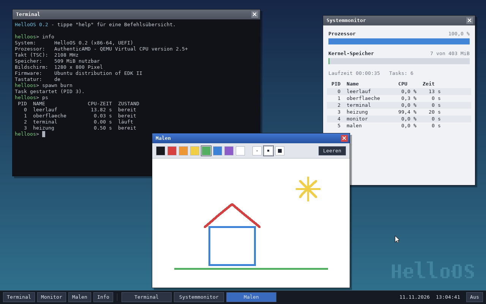

## Was es kann

- **Start über UEFI** wie jedes aktuelle Betriebssystem: HelloOS ist eine
  einzige Datei (`BOOTX64.EFI`), die die Firmware direkt lädt
- **64-Bit-Kernel** mit eigenen Seitentabellen, Interrupt-Behandlung,
  Speicherverwaltung und präemptivem Multitasking
- **Grafische Oberfläche**: Fenster zum Verschieben, Vergrößern und
  Maximieren, Taskleiste mit Startmenü,
  Mauszeiger, geglättete Schrift – gezeichnet direkt in den Bildspeicher der
  Grafikkarte
- **Programme**: Browser, Terminal mit Shell (mehrere gleichzeitig), Texteditor,
  Dateiübertragung, Systemmonitor, Malprogramm, Info- und Ausschalten-Dialog
- **Browser**: zeigt Webseiten in echter Schrift mit Überschriften, Links,
  Formularen und Bildern (PNG, JPEG, GIF), wertet die Stylesheets der Seite
  aus (Farben, Hintergründe, Schriftgrößen, Ausrichtung, Ausgeblendetes,
  Bilder und Kästen neben dem Text), meldet sich an (Cookies) und prüft bei
  https den Server
- **JavaScript** mit einer eigenen Maschine (abschaltbar, ausgeliefert: aus):
  die Sprache auf heutigem Stand (`async`/`await`, Generatoren, Klassen mit
  privaten Feldern, `Proxy`, `Map`/`Set`, `Intl`, Module mit `import`/`export`
  …) – genug für jQuery, React und die WordPress-Verwaltung; große
  Web-Anwendungen noch nicht
- **Echte Schriften**: ein eigener TrueType-Renderer zeichnet Text in jeder
  Größe aus den eingebauten Schriftdateien (DejaVu Sans) – in Fenstertiteln,
  Menüs, Dialogen und im Browser
- **Eigene Dateien bleiben erhalten**: Sie werden auf dem Datenträger
  gesichert, von dem HelloOS startet, und sind dort auch unter Windows zu sehen
- **Neben Windows**: vom USB-Stick – oder fest eingerichtet in einer eigenen
  Partition der internen Platte (NVMe, SATA), mit Eintrag im Startmenü des PCs
- **Dateien mit einem Server austauschen** über SFTP – verschlüsselt, mit
  Prüfung des Serverschlüssels; als Fenster mit zwei Spalten oder im Terminal
- **Eingabegeräte**: USB-Tastaturen und -Mäuse (xHCI, auch An- und Abstecken
  im Betrieb) sowie PS/2, wie es viele Notebook-Tastaturen intern noch nutzen;
  deutsche und US-Tastaturbelegung
- **Netzwerk**: Treiber für Intel-Netzwerkkarten (auch I225/I226), eigener Stack mit ARP, IPv4,
  ICMP, UDP, DHCP, DNS und TCP, dazu HTTP und HTTPS (TLS 1.3 mit
  Zertifikatsprüfung)
- **Claude eingebaut**: ein Chatfenster und der Befehl `claude` – Claude
  beantwortet Fragen und kann in HelloOS nachsehen und Befehle ausführen
- **Updates**: HelloOS sucht regelmäßig nach neuen Versionen, prüft deren
  Signatur, zeigt, was neu ist, und installiert sie nach deiner Zustimmung auf
  dem Datenträger, von dem es gestartet wurde
- **Ton**: Klänge beim Start, beim Herunterfahren, bei Rückfragen und Fehlern
  über Intel HD Audio, mit Lautstärkeknopf in der Taskleiste
- 35 Shell-Befehle
- **Serielle Konsole** mit eigener Shell – praktisch für Tests ohne Bildschirm

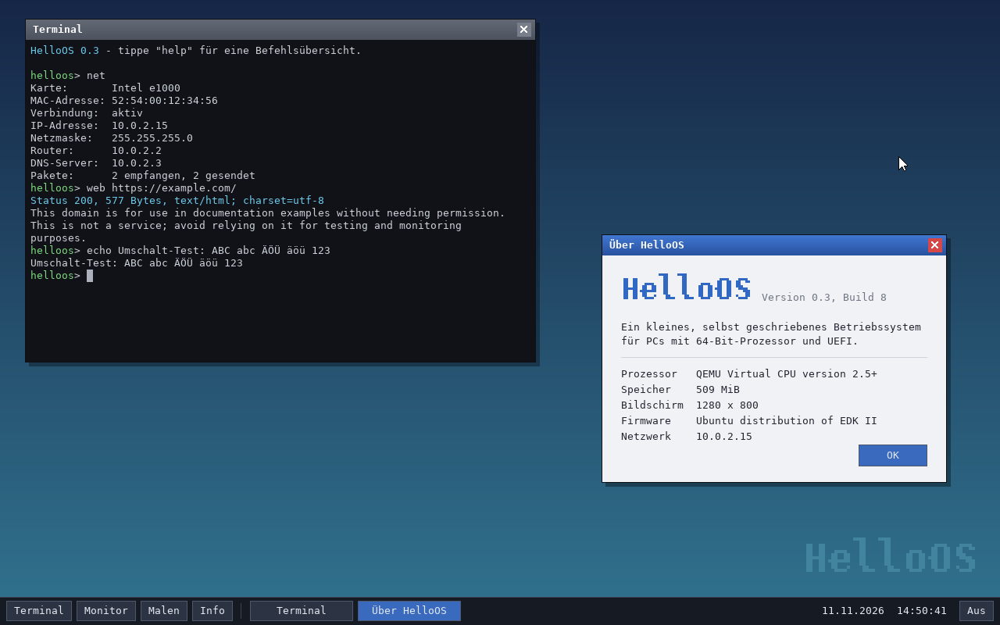

## Bauen und in QEMU starten

Benötigt werden `clang`, `lld`, `nasm`, `make` und `python3`, zum Ausprobieren
außerdem QEMU mit der UEFI-Firmware OVMF. Unter Debian/Ubuntu:

```sh
sudo apt install clang lld nasm make python3 qemu-system-x86 ovmf
```

Dann in diesem Verzeichnis:

```sh
make            # baut build/BOOTX64.EFI und das Disk-Image build/helloos.img
make run        # startet HelloOS in einem QEMU-Fenster
make run-usb    # dasselbe mit USB-Tastatur und -Maus statt PS/2
make test       # bootet ohne Bildschirm und prüft die wichtigsten Befehle
make check      # prüft Kryptografie und Browser-Unterbau auf dem Entwicklungsrechner
```

In QEMU steckt das Image als USB-Stick an einem emulierten USB-3-Controller,
dazu kommt eine emulierte Netzwerkkarte mit Internetzugang über den
Wirtsrechner. `make check` braucht zusätzlich die Python-Pakete `cryptography` und `Pillow`
und einen gewöhnlichen C-Compiler (`cc`).

Liegt die Firmware an einem ungewöhnlichen Ort: `make run OVMF=/pfad/zu/OVMF.fd`.
Unter macOS liefert Homebrew alles Nötige (`brew install llvm lld nasm qemu`);
`clang` und `lld-link` gibt man dann mit `make CC=... LD=...` an.

## Auf einem echten PC starten – auch neben Windows

> HelloOS ist fast nur in QEMU getestet. Auf echter Hardware lief es bisher
> auf genau einem PC (Mini-PC mit Intel Core Ultra): Start vom Stick,
> Funk-Tastatur und -Maus hinter dem eingebauten USB-Hub, Netzwerk mit einer
> I226 samt Adresszuteilung. Vom
> Stick gestartet, schreibt es nur auf diesen Stick – die interne Platte ist
> für HelloOS schreibgeschützt, solange du es dort nicht ausdrücklich
> einrichtest (siehe unten). Ein Versuch vom Stick ist also ungefährlich, aber
> es kann sein, dass es auf einem bestimmten Rechner nicht startet.

1. USB-Stick vorbereiten – eine der beiden Möglichkeiten:
   - Stick mit FAT32 formatieren und `build/BOOTX64.EFI` als
     `EFI/BOOT/BOOTX64.EFI` daraufkopieren (geht mit jedem Betriebssystem), oder
   - das fertige Image auf den Stick schreiben, z. B. unter Linux mit
     `sudo dd if=build/helloos.img of=/dev/sdX bs=1M conv=fsync`
     (**Achtung:** `/dev/sdX` muss wirklich der Stick sein, er wird überschrieben).
2. Im UEFI-Setup des PCs **Secure Boot ausschalten** – HelloOS ist nicht signiert.
   **Vorher unbedingt lesen:** den Hinweis zu BitLocker weiter unten.
3. Vom Stick starten (Boot-Menü, meist F12, F11, F8 oder Esc).

Reagieren Tastatur und Maus nicht, öffnet HelloOS nach etwa 15 Sekunden von
selbst ein Diagnosefenster mit dem Startprotokoll. Es zeigt für jeden
USB-Anschluss, welches Gerät dort erkannt wurde und warum es nicht bedient
wird – ein Foto davon ist die beste Grundlage für eine Fehlermeldung.
Dasselbe Protokoll zeigt im Terminal der Befehl `log`.

### Neben Windows: zwei Wege

**Weg 1 – der USB-Stick (einfach und ohne Risiko für Windows).** Steckt der
Stick und wählst du ihn im Boot-Menü, startet HelloOS; sonst startet Windows
wie immer. Deine Dateien, Updates und gemerkten Server liegen auf dem Stick.
Die interne Platte wird dabei nicht beschrieben.

**Weg 2 – auf der internen Platte, in einer eigenen Partition.** Dann startet
HelloOS ohne Stick aus dem Startmenü des PCs und speichert auf der internen
Platte. Das ist der nächste Abschnitt.

> **BitLocker / Geräteverschlüsselung – gilt für beide Wege:** Auf den meisten
> PCs mit Windows 11 (und vielen mit Windows 10) ist die Festplatte
> verschlüsselt, und der Schlüssel ist an Secure Boot gebunden. Schaltest du
> Secure Boot aus, verlangt Windows beim nächsten Start den **BitLocker-
> Wiederherstellungsschlüssel** (48 Ziffern). Besorge ihn dir vorher – er
> steht in deinem Microsoft-Konto unter „Geräte" → „BitLocker-Schlüssel" –
> oder halte den Schutz in Windows vor der Umstellung an („BitLocker
> verwalten" → „Schutz anhalten"). Ohne diesen Schlüssel kommst du nicht mehr
> an deine Daten. Schaltest du Secure Boot wieder ein, ist alles wie vorher.

### Auf der internen Platte einrichten

> **Bitte zuerst lesen.** Dieser Teil ist in QEMU gründlich geprüft (siehe
> unten), aber **noch nie auf einem echten PC gelaufen**. HelloOS schreibt
> dann mit eigenen Treibern auf dieselbe Platte, auf der Windows liegt. Es ist
> so gebaut, dass es nur seine eigene Partition anfassen kann – ein Fehler,
> der sich erst auf echter Hardware zeigt, lässt sich trotzdem nicht
> ausschließen. **Mach vorher eine Sicherung deiner wichtigen Daten** auf
> einen anderen Datenträger. Wer das nicht kann oder will, bleibt bei Weg 1.

Was du brauchst: einen PC mit UEFI, eine NVMe-SSD oder eine SATA-Platte (im
Modus „AHCI"), den HelloOS-Stick und – wegen Secure Boot – den
BitLocker-Schlüssel (siehe oben).

**1. In Windows eine Partition für HelloOS anlegen**

1. Rechtsklick auf den Startknopf → „Datenträgerverwaltung".
2. Rechtsklick auf das Laufwerk C: → „Volume verkleinern…" und zum Beispiel
   4000 MB abgeben. (Windows verschiebt dabei nichts Wichtiges; das dauert
   kurz.)
3. Rechtsklick auf den neuen Bereich „Nicht zugeordnet" → „Neues einfaches
   Volume…". Dateisystem **FAT32**, Volumebezeichnung **HELLOOS** – genau so
   geschrieben. An diesem Namen erkennt HelloOS seine Partition.
4. Empfohlen: In Windows den **Schnellstart ausschalten** (Systemsteuerung →
   Energieoptionen → „Auswählen, was beim Drücken von Netzschaltern geschehen
   soll" → Häkchen bei „Schnellstart aktivieren" entfernen). Sonst kann
   Windows beim nächsten Start einen veralteten Stand dieser Partition im
   Gedächtnis haben und dort Dateien von HelloOS durcheinanderbringen.

**2. Vom Stick starten und einrichten lassen**

Starte den PC vom HelloOS-Stick. Findet HelloOS eine Partition namens
HELLOOS, auf der es noch nicht eingerichtet ist, erscheint – noch vor der
Oberfläche, als Text – die Frage, ob es das jetzt tun soll. Mit **J**:

- wird die Startdatei auf diese Partition kopiert und zur Kontrolle
  zurückgelesen,
- entsteht im Startmenü des PCs der Eintrag **„HelloOS"** – hinten angestellt,
  sodass **Windows weiterhin von allein startet**.

Beides erledigt die Firmware des PCs mit ihren eigenen Treibern; HelloOS
selbst schreibt in diesem Schritt keinen einzigen Sektor. Jede andere Taste
(oder 30 Sekunden Warten) lässt alles, wie es ist.

**3. Ohne Stick starten**

Stick abziehen, PC einschalten, das Startmenü des PCs aufrufen (meist F12,
F11, F8 oder Esc) und „HelloOS" wählen. `disk` zeigt dann, wo HelloOS
speichert: in der eigenen Partition auf der internen Platte. Auch Updates
landen ab jetzt dort.

**Wie die Trennung von Windows gesichert ist**

- Interne Platten sind für HelloOS zunächst **komplett schreibgeschützt**.
  Freigegeben wird nur der Bereich der einen Partition, die HELLOOS heißt
  *und* die HelloOS-Startdatei enthält. Jeder Schreibversuch außerhalb wird
  an der letzten Stelle vor dem Treiber abgewiesen – unabhängig davon, was
  der Rest des Systems vorhat.
- Der Windows-Startbereich (die EFI-Partition) wird nie beschrieben; der
  Starteintrag liegt im Speicher der Firmware, nicht auf der Platte.
- Geprüft in QEMU mit nachgestellter Windows-Platte (Startbereich, „Windows"
  als Zufallsdaten, Wiederherstellungspartition), jeweils mit NVMe und SATA:
  einrichten, ohne Stick starten, Dateien schreiben, 3-MB-Datei laden, Update
  installieren, neu starten. Danach war **alles außerhalb der
  HelloOS-Partition Bit für Bit unverändert** (Prüfsumme über die ganze
  Platte) und das Dateisystem der Partition laut `fsck` in Ordnung.

**Was nicht geht oder zu beachten ist**

- PCs, deren SSD im Modus „Intel RST" / „RAID" / „VMD" läuft (bei vielen
  Notebooks mit Intel-Prozessor die Werkseinstellung): HelloOS sieht die
  Platte dann nicht. Es startet zwar, speichert aber nur mit eingestecktem
  Stick. Den Modus im UEFI-Setup umzustellen, kann Windows am Starten hindern
  – das bitte nicht ohne Anleitung des Herstellers tun.
- Platten mit 4096-Byte-Sektoren („4Kn") und Partitionen, die über Windows
  als „BitLocker To Go" verschlüsselt wurden, werden nicht unterstützt.
- Wieder entfernen: In der Datenträgerverwaltung das Volume HELLOOS löschen
  und C: wieder „erweitern". Der Eintrag „HelloOS" im Startmenü des PCs läuft
  dann ins Leere; er lässt sich im UEFI-Setup löschen oder einfach ignorieren.

Was dabei zu beachten ist:

- Stick, Tastatur und Maus dürfen direkt am Rechner oder hinter einem
  **USB-Hub** stecken – auch hinter den fest eingebauten Hubs, an denen in
  manchen PCs die Buchsen hängen, und hinter mehreren Hubs in Reihe. Geprüft
  ist das in QEMU mit dessen (langsamem) USB-1.1-Hub und auf einem echten PC
  mit langsamen Geräten an einem USB-2-Hub. Geräte an einem USB-3-Hub sind
  ungeprüft.
- Unterstützt werden USB-Tastaturen und -Mäuse, auch über Funkempfänger.
  Tastaturen liest HelloOS im einfachen „Boot-Protokoll"; bei allem anderen
  richtet es sich nach der Beschreibung, die das Gerät über seine Daten
  mitliefert. So versteht es auch Empfänger, die über einen Kanal
  Mausbewegungen, Sondertasten und anderes mischen, und übergeht, was weder
  Maus noch Tastatur ist. Das Mausrad blättert in Browser, Editor und
  Claude-Fenster. Bluetooth-Geräte und Touchpads, die nur über I²C
  angebunden sind, funktionieren nicht – dann hilft eine USB-Maus oder die
  Bedienung per Tastatur.
- **Netzwerk gibt es nur per Kabel** und nur mit Netzwerkchips von Intel:
  - die e1000-Familie („Intel Ethernet Connection I217/I218/I219" und ältere),
  - die 2,5-Gigabit-Chips **I225 und I226** aktueller PCs und Mini-PCs,
  - deren 1-Gigabit-Verwandte 82576, I210 und I211.

  Getestet sind die Treiber mit den Modellen, die QEMU nachbildet (zwei aus
  der e1000-Familie und der 82576). I225 und I226 bildet QEMU nicht nach: Der
  Treiber folgt für sie Intels Unterlagen und teilt sich den geprüften Code
  mit dem 82576; auf einem echten PC mit zwei I226-Anschlüssen hat er eine
  Adresse bezogen, mehr ist dort noch nicht geprüft. Hat der
  PC mehrere Anschlüsse, wird der benutzt, an dem ein Kabel steckt.
  **WLAN und Realtek-Karten werden nicht unterstützt.** `net` zeigt, ob eine
  Karte erkannt wurde; eine nicht unterstützte nennt HelloOS beim Start mit
  ihrer Kennung.
- Es wird nur ein Prozessorkern benutzt und ohne Grafikbeschleunigung
  gezeichnet. Bei sehr hohen Auflösungen wählt HelloOS, wenn die Firmware das
  anbietet, einen Modus bis 1920 × 1200.
- Erscheint statt der Oberfläche ein Startprotokoll, das stehen bleibt, zeigt
  dessen letzte Zeile, wie weit der Start gekommen ist.

## Bedienung

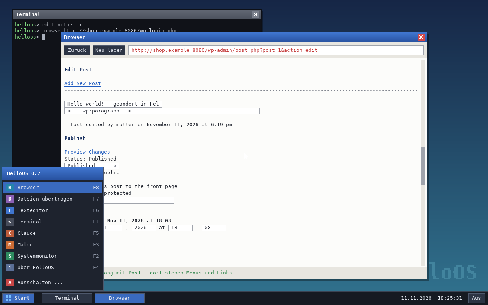

| Aktion | Maus | Tastatur |
| --- | --- | --- |
| Startmenü öffnen | „Start" unten links | Windows-Taste oder Strg+Esc, dann Pfeiltasten und Enter |
| Programm starten | im Startmenü anklicken | F1 Terminal, F2 Monitor, F3 Malen, F4 Info, F5 Claude, F6 Editor, F7 Transfer, F8 Browser |
| Fenster wechseln | Fenster oder dessen Knopf in der Taskleiste anklicken | Alt+Tab |
| Fenster verschieben | an der Titelleiste ziehen | – |
| Fenstergröße ändern | am Griff in der rechten unteren Ecke ziehen | – |
| Fenster maximieren / zurück | Knopf mit dem Rechteck neben dem ✕ | Alt+F10 |
| Fenster schließen | ✕ in der Titelleiste | Alt+F4 |
| Lautstärke | Knopf „Ton" in der Taskleiste: jeder Klick eine Stufe leiser, zuletzt aus | `sound 50`, `sound aus` im Terminal |
| Ausschalten / Neustart | „Aus" rechts in der Taskleiste | `shutdown` bzw. `reboot` im Terminal |

### Befehle im Terminal

| Befehl | Wirkung |
| --- | --- |
| `help` | Befehlsübersicht |
| `info` | System, Build-Nummer, Prozessor, Speicher, Bildschirm |
| `mem` | Heap-Belegung und Speicherkarte der Firmware |
| `uptime`, `date` | Laufzeit bzw. Datum und Uhrzeit |
| `ps` | Tasks mit Zustand und verbrauchter CPU-Zeit |
| `spawn counter [n]` | Hintergrund-Task, der im Sekundentakt bis *n* zählt |
| `spawn burn` | Hintergrund-Task, der pausenlos rechnet (zeigt die Präemption) |
| `kill <pid>` | Task beenden |
| `start <programm>` | `terminal`, `monitor`, `malen`, `info`, `claude`, `editor`, `transfer`, `browser` oder `aus` öffnen |
| `net` | Netzwerkkarte, Adressen, Paketzähler; `net dns <adresse>` setzt den DNS-Server |
| `ping <ziel>` | prüft, ob ein Rechner antwortet |
| `dns <name>` | löst einen Namen in eine IPv4-Adresse auf |
| `web <adresse>` | holt eine Webseite und zeigt sie als Text |
| `browse [adresse]` | öffnet eine Webseite im Browser-Fenster (siehe [Browser](#browser)) |
| `get <adresse> <datei>` | lädt eine Datei aus dem Netz zu den eigenen Dateien |
| `sftp <benutzer>@<server>` | Dateien verschlüsselt mit einem Server austauschen (siehe [unten](#webseite-bearbeiten-editor-und-dateiübertragung)) |
| `update` | sucht jetzt nach einem Update und fragt, ob es installiert werden soll |
| `news` | zeigt, was in der laufenden Version neu ist |
| `claude <frage>` | mit Claude sprechen (siehe [Claude](#claude)) |
| `disk` | zeigt alle Datenträger, ihre FAT32-Partitionen und wo HelloOS speichert |
| `log [fenster]` | Startprotokoll: was die Treiber beim Start gemeldet haben (USB-Geräte, Netzwerk, Ton, Datenträger) |
| `ls`, `cat <datei>`, `rm <datei>` | Dateien auflisten, anzeigen, löschen |
| `edit [datei]` | Datei im Texteditor öffnen (oder neu anlegen) |
| `sha256 <datei>` | Prüfsumme einer Datei |
| `write <datei> <text>` | Datei (über)schreiben |
| `append <datei> <text>` | Zeile anhängen |
| `echo <text>` | Text ausgeben |
| `sound [0-100\|aus\|test]` | Soundkarte und Lautstärke anzeigen, Lautstärke setzen, Klang abspielen |
| `keymap [de\|us]` | Tastaturbelegung anzeigen oder umschalten (Standard: `de`) |
| `history`, `clear` | Befehlsverlauf, Terminal leeren |
| `panic` | löst absichtlich eine CPU-Ausnahme aus |
| `reboot`, `shutdown` | Neustart, Herunterfahren |

In der Größe ändern lassen sich Browser, Terminal, Texteditor,
Dateiübertragung und Claude; Systemmonitor, Malprogramm und die Dialoge haben
eine feste Größe. Beim Ziehen zeigt ein Rahmen die künftige Größe – das
Fenster folgt, sobald du loslässt.

Pfeil hoch/runter blättert im Verlauf, Strg+C verwirft die Eingabe,
Strg+L leert das Terminal.

## Ton

HelloOS meldet sich mit Klängen: einem aufsteigenden Akkord beim Start, dem
gleichen abwärts beim Herunterfahren, einem kurzen Zweiklang, wenn eine
Rückfrage auf dich wartet (Update, Erlaubnis für Claude, Serverschlüssel,
Überschreiben, ungesicherte Änderungen), und einem tieferen bei Fehlern. Die
Klänge sind nicht aufgenommen, sondern werden beim Start aus Sinustönen
errechnet.

Unterstützt wird **Intel HD Audio**, die Soundkarte fast aller PCs. Der
Treiber fragt den Wandler-Chip ab, sucht alle analogen Ausgänge (Lautsprecher,
Kopfhörer, Line-Ausgang) und schaltet sie ein. `sound` zeigt, was er gefunden
hat; ohne brauchbare Soundkarte bleibt HelloOS still und der Knopf „Ton"
erscheint nicht.

Was dabei zu wissen ist:

- **Kein Ton über HDMI oder DisplayPort.** Dafür müsste HelloOS auch die
  Grafikkarte ansteuern. Bei einem PC ohne eigene Lautsprecher kommt der Ton
  also nur aus der Kopfhörerbuchse – nicht aus den Lautsprechern des Monitors.
- **Getestet nur in QEMU**, mit drei nachgebildeten Soundkarten; dort wird die
  Ausgabe mitgeschnitten und auf die erwarteten Tonhöhen und Lautstärken
  geprüft. Echte Wandler-Chips unterscheiden sich stark – es ist gut möglich,
  dass ein bestimmter PC stumm bleibt. Die Meldung beim Start (`Ton: …`) sagt
  dann, wie weit der Treiber gekommen ist.
- Keine Aufnahme, keine Musik- oder Videowiedergabe, kein Ton aus dem Browser.

## Browser

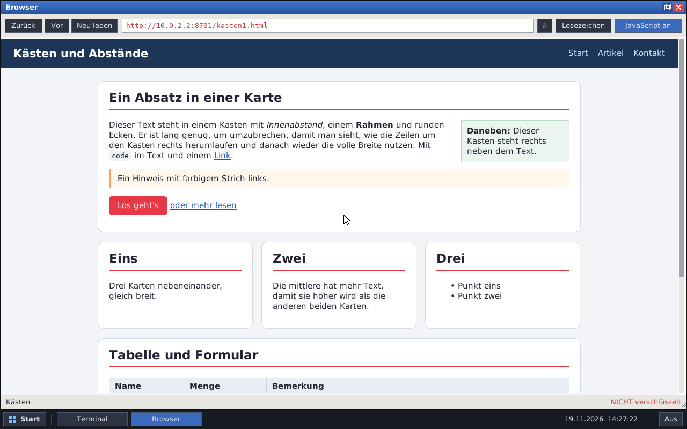

Startmenü → „Browser", F8 oder `browse adresse` im Terminal. Der Browser
holt eine Seite samt ihren Stylesheets und setzt sie selbst – seit 0.24 so,
wie ihre Gestaltung es verlangt: Jedes Element ist ein Kasten mit Außen- und
Innenabstand, Rahmen und Hintergrund; Kästen stehen untereinander,
nebeneinander oder frei platziert, und der Text läuft in Zeilen eigener Höhe
in echter Schrift. Die Skripte der Seite (JavaScript) führt er aus, wenn du
das einschaltest – siehe [JavaScript](#javascript).

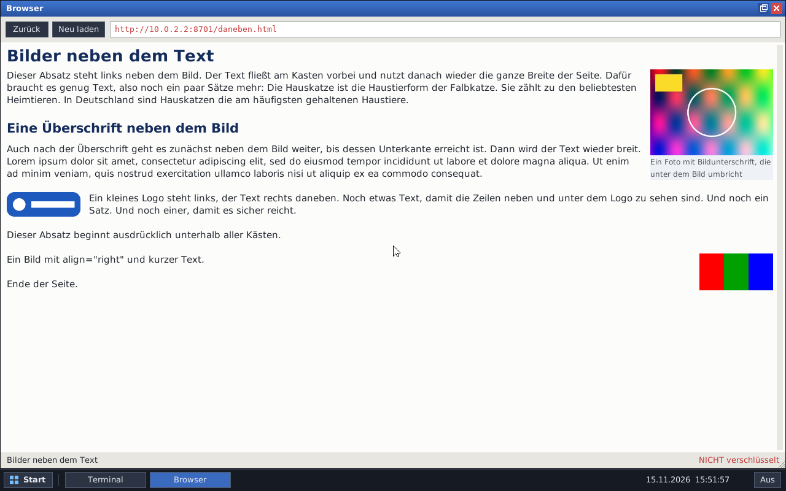

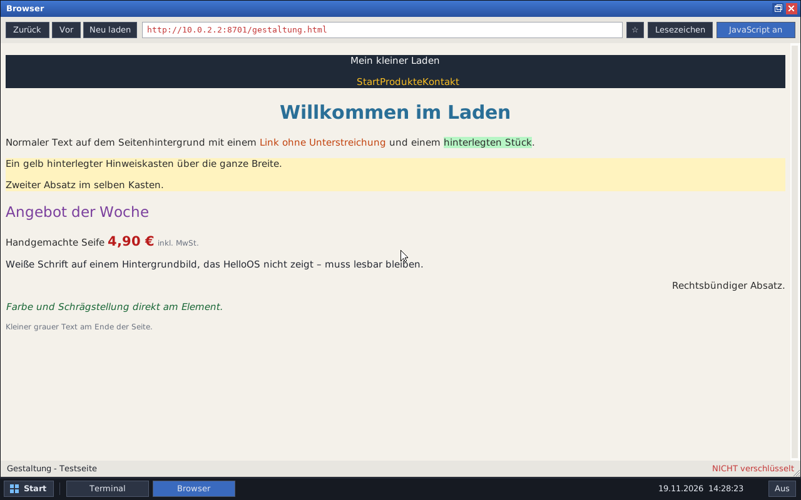

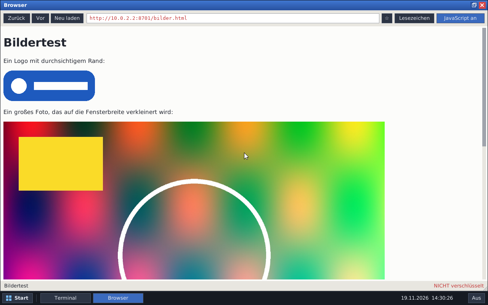

Was er kann:

- Links folgen, zurück und vor (Knöpfe, Alt+Pfeil links/rechts), neu laden;
  Adressen eingeben (Strg+L)
- **Lesezeichen**: Der Stern neben der Adresszeile (oder Strg+D) merkt sich
  die gezeigte Seite, „Lesezeichen" (Strg+B) zeigt alle; sie stehen auch auf
  der Startseite und bleiben auf dem Stick gespeichert. Von dort geht es auch
  zum **Verlauf** des Fensters.
- **Auf der Seite suchen** (Strg+F): Jede Fundstelle wird gelb hinterlegt,
  Enter springt zur nächsten, Umschalt+Enter zurück, Esc schließt die Suche.
  (Gesucht wird innerhalb einer Zeile: Mehrere Wörter, zwischen denen die
  Zeile umbricht oder die Schrift wechselt, findet die Suche nicht.)
- **Schriftgröße** in vier Stufen (Strg und +, − oder 0) und der **Quelltext**
  der Seite (Strg+U)
- Formulare ausfüllen und absenden: Textfelder, Passwörter, Häkchen,
  Auswahllisten, mehrzeilige Textfelder (öffnen einen kleinen Editor)
- sich anmelden: Cookies bleiben erhalten, solange das Fenster offen ist –
  danach sind sie weg, gespeichert wird nichts
- Steht der Mauszeiger über einem Link, zeigt die Statuszeile, wohin er
  führt.
- https mit Prüfung des Servers; die Statuszeile zeigt, ob die Verbindung
  verschlüsselt ist. Soll ein Passwort unverschlüsselt (http) gesendet werden,
  fragt der Browser vorher nach.
- Dateien, die keine Webseiten sind, landen bei den eigenen Dateien
- **Bilder** in den Formaten PNG, JPEG (auch „progressiv") und GIF (das erste
  Einzelbild). Die Seite ist sofort lesbar; die Bilder lädt ein Helfer im
  Hintergrund nach, die Statuszeile zählt mit. Ein Bild steht als Block für
  sich oder – wenn die Seite es so will – neben dem Text; große werden auf
  die Fensterbreite verkleinert. Ein Klick auf ein
  verlinktes Bild folgt dem Link. Was nicht geladen werden kann, erscheint
  als Ersatztext („[Bild: …]").
- Das Mausrad blättert.
- **Gestaltung der Seite (CSS):** Der Browser lädt die Stylesheets der
  Seite (höchstens zwölf Dateien) und setzt sie nach dem **Kastenmodell**:
  - **Abstände, Rahmen, Hintergründe:** `margin` (auch `auto` zum
    Zentrieren; aneinanderstoßende Abstände verschmelzen wie üblich),
    `padding`, `border` (durchgezogen, gestrichelt, gepunktet; je Seite
    eigene Breite und Farbe), `border-radius`, Hintergrundfarben – auch für
    Elemente mitten im Text.
  - **Hintergrundbilder und Verläufe** (seit 0.25): `background-image` mit
    Wiederholung, Lage und Größe (`cover`, `contain`, feste Maße) – also
    auch große Bilder hinter einem Abschnitt und kleine Symbole aus einer
    Sammelgrafik; `linear-gradient` von oben nach unten oder von links nach
    rechts (erste bis letzte Farbe). Bilder behalten ihre durchsichtigen
    Stellen, auch auf farbigem Grund.
  - **Abschneiden** (seit 0.25): Ein Kasten mit `overflow: hidden` ist so
    groß wie verlangt, und was übersteht, ist nicht zu sehen.
  - **Zusätze vor und nach einem Element** (seit 0.25): `::before` und
    `::after` mit `content` – Text, Zeichen nach ihrer Nummer, `attr(…)`,
    Anführungszeichen; auch als eigene Kästen (Zierlinien, Markierungen,
    der übliche Kniff zum Einschließen nebeneinanderstehender Kästen).
  - **Maße:** `width`, `height`, `min-`/`max-width`, `min-height`,
    `box-sizing`; Längen in `px`, `em`, `rem`, `%`, `vw`/`vh`, `pt` und
    Verwandten, mit `calc()`, `min()`, `max()`, `clamp()`.
  - **Text:** Schriftgröße, fett, kursiv, Schreibmaschinenschrift,
    `line-height`, `text-align`, `text-indent`, `text-transform`,
    `white-space` (auch `nowrap` und `pre`), hoch- und tiefgestellt.
    Geschützte Leerzeichen halten zusammen, was zusammengehört; überlange
    Wörter werden zerteilt statt aus dem Fenster zu ragen.
  - **Nebeneinander:** `float` und `clear` (der Text fließt an Kästen
    vorbei), `display: flex` (Richtung, Umbruch, `gap`, `justify-content`,
    `align-items`, `flex: 1`, `order`, `margin: auto`), `display: grid`
    (feste Spalten, Anteile mit `fr`, `minmax` – solche Spalten geben nach,
    wenn es eng wird –, `repeat`, „so viele, wie
    passen", Kinder über mehrere Spalten oder Zeilen, benannte Flächen mit
    `grid-template-areas`), `inline-block`.
  - **Frei platziert:** `position: relative`, `absolute`, `z-index` für die
    Reihenfolge übereinander.
  - **Am Fenster haftend** (seit 0.27): `position: fixed` steht fest im
    Fenster, wie weit die Seite auch rollt (Kopfleisten, Hinweise am unteren
    Rand, „nach oben"-Knöpfe); `position: sticky` mit `top` rollt mit und
    bleibt dann oben haften, bis sein umgebender Kasten aus dem Bild ist –
    auch Kopfzeilen von Tabellen.
  - **Unter dem Mauszeiger** (seit 0.27): Regeln mit `:hover` gelten – Menüs
    klappen auf, wenn die Maus darüber steht, Links und Karten wechseln die
    Farbe. Ebenso `:focus`, `:focus-visible` und `:focus-within` für das
    Feld, in das gerade getippt wird. Neu gesetzt wird die Seite nur, wenn
    eine Regel beim betroffenen Element überhaupt danach fragt; auf
    Seiten, deren Aufbau lange dauert, nur für Auf- und Zuklappen, nicht
    für bloße Farbwechsel.
  - **Durchscheinende Hintergründe** (seit 0.27): Farben mit Deckkraft
    (`rgba(0, 0, 0, 0.5)`, `#rrggbbaa`) lassen durchschimmern, was dahinter
    liegt – etwa der Schleier hinter einem Dialog.
  - **Tabellen:** Spalten so breit wie nötig und so breit wie möglich,
    Zellen über mehrere Spalten oder Zeilen, Rahmen (auch gemeinsame mit
    `border-collapse`), Abstände, Beschriftung, Ausrichtung in der Zelle –
    und die alten Attribute (`border`, `cellpadding`, `width`, `bgcolor`,
    `align`).
  - **Auswahl und Rangfolge:** Element, Klasse, Kennung, Verschachtelung,
    Attribute (`a[href^="http"]`) und seit 0.26 auch Geschwister (`h2 + p`,
    `h2 ~ p`), die Stellung unter den Geschwistern (`:first-child`,
    `:last-child`, `:only-child`, `:nth-child(2n+1)`, dasselbe unter
    Gleichnamigen mit `-of-type`, `:empty`), Verneinung und Auswahl aus
    mehreren (`:not(…)`, `:is(…)`, `:where(…)`), Zustände von Feldern
    (`:checked`, `:enabled`, `:disabled`) und `:lang(…)`. Dazu
    `!important`, `inherit`, Variablen (`var(--name)`), `@supports` und
    `@media` nach Fensterbreite und -höhe (auch mit `calc()`) – wird das
    Fenster breiter oder schmaler, gelten die Bedingungen neu. Jede Seite
    beginnt mit den Grundregeln, die alle Browser mitbringen (Absätze haben
    Abstand, Überschriften sind groß, Listen eingerückt). Regeln, die sich
    hier nicht prüfen lassen (`:active`, `:target`, `:has(…)`), bleiben aus.
  - **Knöpfe** (`<button>`, seit 0.26) sind Kästen wie alle anderen: mit
    ihrem Inhalt (Text, Symbole, Bilder) und dem Aussehen, das die Seite
    ihnen gibt. Schaltflächen von Formularen (`<input type="submit">`)
    bekommen Farbe, Schrift und runde Ecken von der Seite; Eingabefelder
    ihre Größe.
  - Wäre Text auf seinem Hintergrund kaum zu lesen – etwa helle Schrift auf
    einem Hintergrundbild, das nicht gezeigt wird –, nimmt der Browser eine
    lesbare Farbe.

  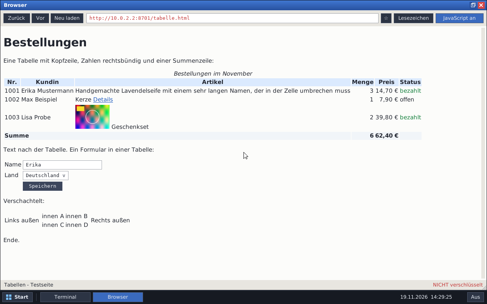

  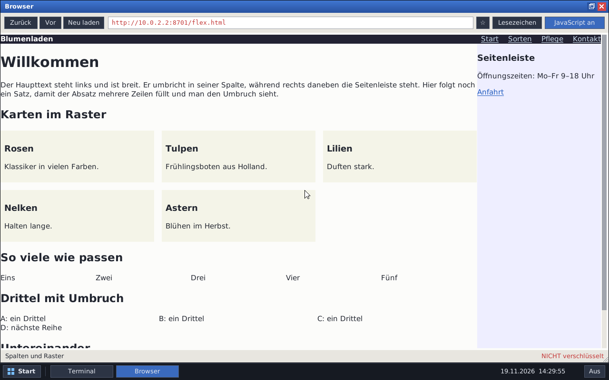

  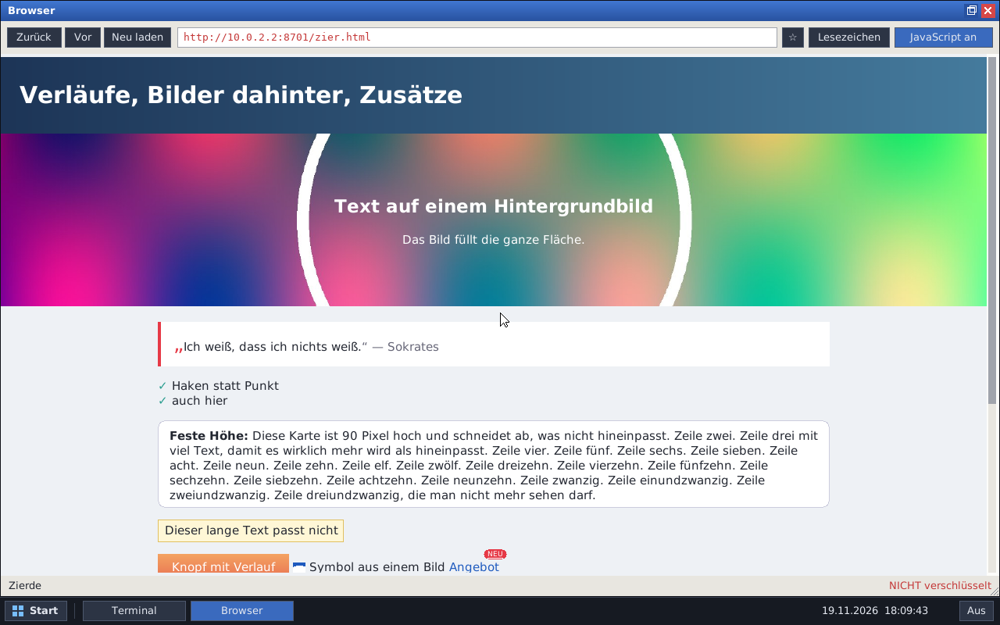

  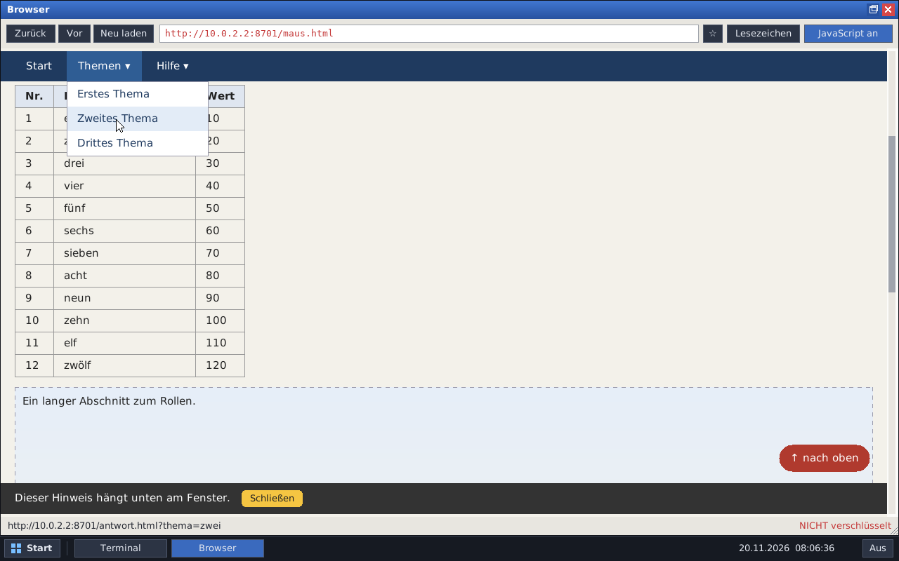
- **Einfache Darstellung** (Strg+E): Zeigt eine Seite wie die Fassungen bis
  0.23 – nur Text, Links, Bilder und Formulare im Zeilenraster, ohne
  Abstände und Rahmen. Gedacht für Seiten, die mit ihrer Gestaltung hier
  nicht zu lesen sind; noch einmal Strg+E schaltet zurück. Die Einstellung
  bleibt gespeichert.
- Was eine Seite nur für Vorleseprogramme bereithält (auf nichts beschnitten
  oder weit aus dem Bild geschoben, etwa „Zum Inhalt springen"), zeigt der
  Browser nicht.

- **HTML5:** Abschnitte (`header`, `nav`, `main`, `article`, `section`,
  `aside`, `footer`, `figure`), hervorgehobener Text (`mark`),
  Fortschrittsbalken (`progress`, `meter`), Hinweistexte in leeren Feldern
  (`placeholder`), die neuen Feldarten (E-Mail, Zahl, Datum, Suche … als
  Textfelder), `hidden`, `template`, `dialog` (nur wenn geöffnet) und
  aufklappbare Abschnitte (`details`; auf- und zuklappen lassen sie sich mit
  eingeschaltetem JavaScript, sonst stehen sie offen da). Für Video, Ton und
  eingebettete Seiten (`video`, `audio`, `iframe`) erscheint ein Hinweis mit
  Link auf die Datei oder Seite; `canvas` und `object` zeigen ihren
  Ersatzinhalt.

Was er **nicht** kann – und das ist bei heutigen Webseiten viel:

- **JavaScript nur zum Teil** und nur, wenn eingeschaltet – was geht und was
  nicht, steht [unten](#javascript). Große Web-Anwendungen laufen nicht.
- von der Gestaltung fehlt noch einiges: Schatten, Durchsichtigkeit,
  Drehen und Bewegen (`transform`, Animationen), eigene Rollbereiche in der
  Seite (`overflow: auto`/`scroll`: Solche Kästen werden so groß wie ihr
  Inhalt), kreisförmige und schräge Verläufe (sie erscheinen einfarbig bzw.
  gerade), mehrere Hintergrundbilder übereinander, Zähler in Zusätzen,
  Symbole aus Symbolschriften und aus Masken (sie bleiben leer),
  mehrspaltiger Text, Durchsichtigkeit ganzer Elemente (`opacity` zwischen 0
  und 1). Haften gibt es nur am oberen Rand (`sticky` mit `bottom` oder zur
  Seite hin bleibt, wo es steht); der Mauszeiger behält seine Form, auch
  über Links. Eingabefelder sehen immer gleich aus. Gesetzt wird in der
  eingebauten Schrift (die Schriftarten der Seite werden nicht geladen);
  Schreibmaschinenschrift gibt es nur in einer Größe. Die Schrift kennt
  lateinische, griechische und kyrillische Zeichen; andere (etwa
  chinesische) erscheinen als leeres Kästchen. Schrift von rechts nach links
  wird nicht gesetzt.
- keine Bilder in den Formaten WebP, AVIF und SVG, keine bewegten GIFs,
  keine Videos
- kein Hochladen von Dateien, keine Tabs (mehrere Browserfenster gehen), kein
  Passwortspeicher; Cookies gelten nur, solange das Fenster offen ist
- Ohne Skripte lässt sich nicht wegklicken, was eine Seite fest ins Fenster
  hängt (Hinweisleisten, Schleier): Dort hilft die einfache Darstellung
  (Strg+E).

### JavaScript

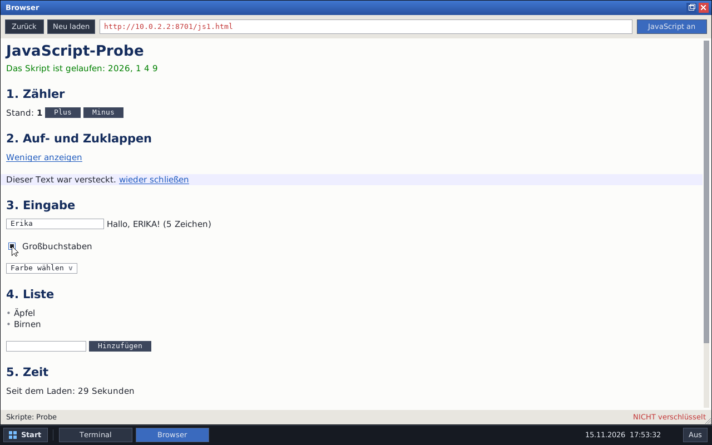

Der Knopf rechts oben in der Leiste schaltet JavaScript ein und aus
(„JavaScript an" / „JavaScript aus"); die Seite wird dann neu geladen, und
die Einstellung bleibt auf dem Stick gespeichert. **Ausgeliefert wird es
ausgeschaltet** – der Grund steht unter „Sicherheit".

HelloOS bringt dafür eine eigene JavaScript-Maschine mit (kein fremder Code):
Sie liest den Quelltext, führt ihn aus und gibt den Skripten ein
veränderbares Abbild der Seite (DOM). Angezeigt wird immer, was in diesem
Abbild steht; ändern Skripte es, setzt der Browser die Seite neu.

**Was geht**

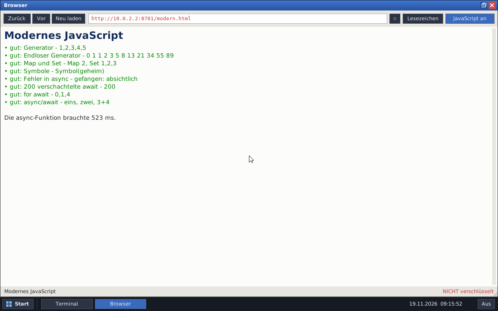

- **Die Sprache auf heutigem Stand** (seit 0.21): alles bis ECMAScript 2015
  und fast alles, was seither dazukam –
  - Funktionen, Objekte, Felder, Zeichenketten, JSON, Datum, Klassen,
    Pfeilfunktionen, `let`/`const`, Vorlagen-Zeichenketten (auch
    ``f`…` ``), Zerlegen (`{a, b} = …`), `?.` und `??`, Zahlen mit
    Trennstrichen (`1_000`);
  - **Generatoren** (`function*`, `yield`, `yield*`) und
    **`async`/`await`**, `for await` und `async`-Generatoren;
  - **Symbole** und das Iterationsprotokoll: `for…of`, Spread und Zerlegung
    arbeiten mit allem, was `[Symbol.iterator]` hat;
  - `Map`, `Set`, `WeakMap`, `WeakSet` (die schwachen geben wirklich frei),
    `Promise` samt `any`/`allSettled`/`withResolvers`, typisierte Felder;
  - Klassen mit **privaten Mitgliedern** (`#x`), `static`-Blöcken und
    Unterklassen der eingebauten Klassen (`extends Array`, `Map`, `Error`);
    `new.target`;
  - **`Proxy` und `Reflect`** – darauf bauen „reaktive" Bibliotheken auf;
  - reguläre Ausdrücke mit benannten Gruppen, Rückwärtsblick und
    `\p{…}`; `Intl` für Zahlen, Daten, Listen und Sortieren (deutsch und
    englisch), `structuredClone`, `TextEncoder`/`TextDecoder`.
- **Module** (seit 0.22): `<script type="module">`, `import` und `export` in
  allen Formen (auch im Kreis und mit `export * from`), `import()` zur
  Laufzeit, `import.meta.url`, `await` ganz außen, Übersetzungstabellen
  (`<script type="importmap">`). Die Dateien eines Moduls holt der Browser
  der Reihe nach; jedes läuft einmal. Skripte mit `nomodule` – die
  Ersatzfassung für alte Browser – bleiben dann aus.
- **Nachfordern** (seit 0.22): Fügt ein Skript später ein `<script src=…>`
  ein (auch von einem anderen Server, etwa „JSONP"), wird es geholt und
  ausgeführt; `onload`/`onerror` melden sich. Fügt es ein Stylesheet ein
  oder ändert eines (`<style>`, `<link>`, `sheet.insertRule()`), wird die
  Gestaltung der Seite neu zusammengesetzt.
- Die Seite lesen und umbauen: `getElementById`, `querySelector(All)`,
  `createElement`, `appendChild`, `innerHTML`, `textContent`, `classList`,
  `style`, `dataset`, Attribute, `document.write`.
- Ereignisse: Klicks (auch auf gewöhnlichen Text), Eingaben und Tasten in
  Feldern, Ankreuzen, Auswählen, Absenden – samt `preventDefault`, also
  Formularprüfung vor dem Absenden. Knöpfe ohne Formular
  (`<button type="button">`) erscheinen und funktionieren; Links der Form
  `javascript:…` auch.
- Zeitgeber (`setTimeout`, `setInterval`), `alert` und `confirm` (als Kasten
  über der Seite; Esc unterdrückt weitere Meldungen der Seite),
  `location.href = …`, `history.back()`.
- **Daten nachladen** mit `XMLHttpRequest` und `fetch` – vom Server der
  Seite und (seit 0.23) **auch von anderen Servern**, mit den Regeln, die
  große Browser dafür haben („CORS"):
  - Die Antwort eines fremden Servers bekommt das Skript nur zu sehen, wenn
    der Server es dieser Seite erlaubt (`Access-Control-Allow-Origin`). Von
    den Kopfzeilen der Antwort sieht es nur die üblichen und die, die der
    Server freigibt.
  - Die Cookies des Benutzers gehen zu einem fremden Server nur mit, wenn
    das Skript es verlangt (`credentials: 'include'`, `withCredentials`)
    **und** der Server genau diese Seite dafür zulässt – „für alle" (`*`)
    reicht dann nicht.
  - Vor allem Ungewöhnlichen (`PUT`, `DELETE`, `PATCH`, eigene Kopfzeilen,
    JSON als Inhalt) fragt der Browser den fremden Server erst mit `OPTIONS`,
    ob er das von dieser Seite annimmt.
  - Weiterleitungen werden verfolgt und bei jedem Schritt neu geprüft; geht
    es über einen fremden Server zu einem dritten, heißt die Herkunft dort
    `null`.
  - Von einer verschlüsselten Seite aus geht nichts Unverschlüsseltes hinaus.
  - `mode: 'no-cors'` schickt eine einfache Anfrage ab, ohne dass das Skript
    die Antwort sieht (`navigator.sendBeacon` ebenso).

  Während ein Skript auf die Antwort wartet, wartet auch das Fenster.

  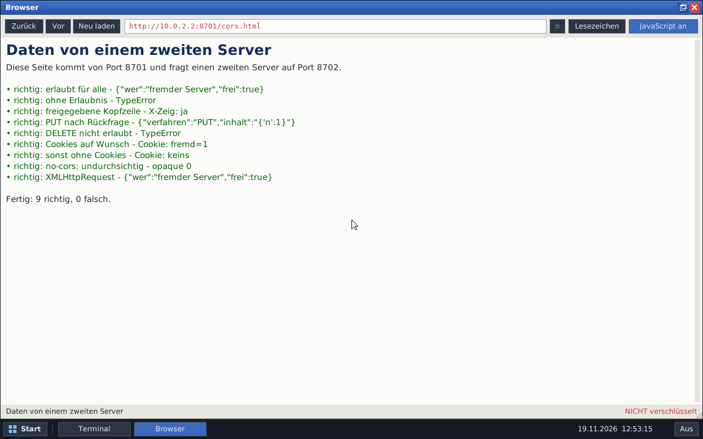
- Ein- und Ausblenden: Skripte erfahren, was laut Stylesheet zu sehen ist
  (`getComputedStyle(…).display`, `offsetWidth`), und was sie per
  `style.display` zeigen, erscheint.
- **Maße und Lage** (seit 0.26): Skripte erfahren, wo ein Element auf der
  Seite steht und wie groß es ist – `getBoundingClientRect`, `offsetTop`,
  `offsetLeft`, `offsetWidth`/`-Height`, `offsetParent`, `clientWidth`/
  `-Height`, `scrollHeight`, `getComputedStyle(…).width` und Verwandte in
  Pixeln, `document.elementFromPoint`. Die Zahlen kommen aus demselben
  Seitenaufbau, der auch anzeigt; hat ein Skript die Seite seit der letzten
  Frage verändert, wird sie zum Messen eigens neu gesetzt.
- **Rollen** (seit 0.26): `window.scrollTo`, `scrollBy`,
  `element.scrollIntoView` und `scrollTop` bewegen die Anzeige; `scrollY`
  stimmt, und rollt der Benutzer, erfahren es die Skripte (`scroll`).
  **„Ist es im Bild?"** – `IntersectionObserver` prüft wirklich, was im
  sichtbaren Ausschnitt liegt (mit Rand und Schwellen): Bilder und Inhalte,
  die eine Seite erst beim Hinrollen lädt, erscheinen dann. `ResizeObserver`
  meldet geänderte Größen.
- **Fenstergröße** (seit 0.26): Wird das Fenster größer oder kleiner,
  erfahren es die Skripte (`resize`, `innerWidth`, `matchMedia(…)` samt
  `change`).
- **Maus** (seit 0.27): Skripte erfahren, worüber der Mauszeiger steht –
  `mouseover`, `mouseout`, `mouseenter`, `mouseleave` und (wenn jemand
  zuhört) `mousemove`, jeweils mit der Lage des Zeigers; auch Klicks tragen
  sie. `document.activeElement` nennt das Feld, das gerade bedient wird.
- **Änderungen beobachten** (seit 0.27): `MutationObserver` meldet, was
  Skripte am Abbild der Seite ändern – neue und entfernte Kinder, Attribute
  (auf Wunsch mit altem Wert und Filter), Text; für ein Element oder alles
  darunter (`subtree`). Viele Bibliotheken warten damit auf Elemente, die
  erst später entstehen.

  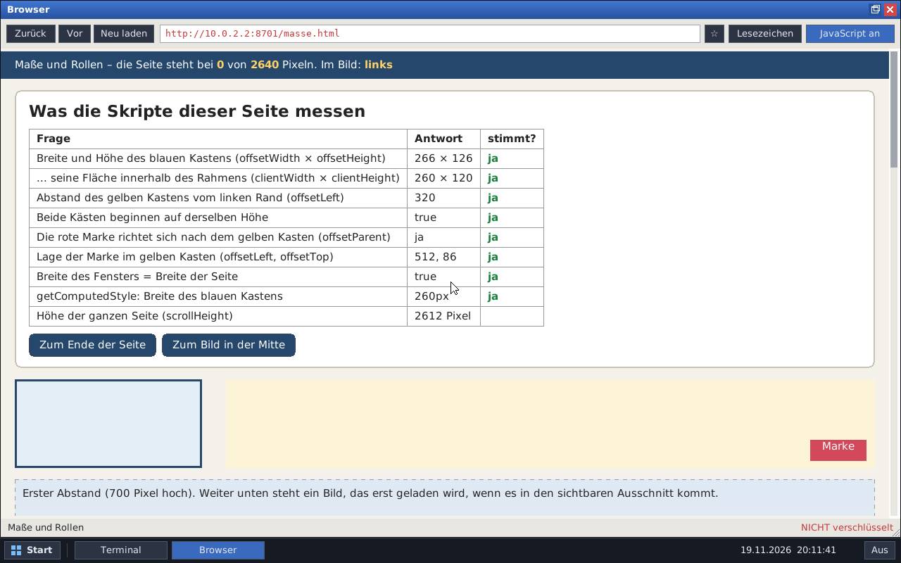
- **jQuery** (getestet mit 3.7) läuft samt Selektoren, Ein-/Ausblenden,
  Animationen (in Schritten) und `$.ajax`.
- **React** (getestet mit 18.2, wie es WordPress mitbringt): Komponenten mit
  Zustand (`useState`, `useEffect`, `useMemo`) erscheinen und reagieren auf
  Klicks.

**Was nicht geht**

- Kleine Abweichungen von der Sprache: Zeichenketten zählen ganze Zeichen
  (ein Emoji hat die Länge 1, nicht 2); große Ganzzahlen (`10n`) sind
  gewöhnliche Zahlen und über 2^53 hinaus ungenau; `with` gibt es nicht;
  `\p{…}` kennt nur die großen Zeichenbereiche; `Intl` nur Deutsch und
  Englisch; `WeakRef` hält sein Ziel fest.
- Alles, was zeichnet oder abspielt: Canvas, WebGL, Video, Ton. Kein
  `localStorage` über das Fenster hinaus, keine Web Worker, kein WebSocket.
- Bei Maßen und beim Rollen: Rollen lässt sich nur die ganze Seite, nicht
  ein Bereich darin (`overflow: auto`). Ein Skript, das abwechselnd ändert und
  misst, lässt die Seite jedes Mal neu setzen; damit das nicht ausufert,
  bekommt es je Ereignis nach zwölf Mal oder 0,8 Sekunden (beim Laden: nach
  sechzig Mal oder vier Sekunden) die Maße vom letzten Stand. In der einfachen Darstellung
  (Strg+E) gibt es keine Maße – dort gilt weiter die alte Annahme (alles
  Sichtbare steht am Seitenanfang und ist „im Bild").
- Maus: Ziehen geht nicht – `mousedown` und `mouseup` kommen erst zusammen
  mit dem Klick, und Schieberegler, Sortieren durch Ziehen oder Zeichnen mit
  gedrückter Taste funktionieren deshalb nicht. Rechtsklick, Doppelklick und
  das Mausrad melden sich den Skripten nicht.
- Beim Nachladen: Antworten kommen als Ganzes, nicht als Strom
  (`response.body`), und als Text (`text()`, `json()`) – Binärdaten wie
  Bilder (`blob()`) gehen nicht. Skriptdateien, Module und Daten werden
  nacheinander geholt; solange wartet das Fenster.
- Tempo: Die Maschine deutet den Quelltext Schritt für Schritt, statt ihn zu
  übersetzen – grob hundertmal langsamer als ein großer Browser. Ein Skript
  darf zehn Sekunden rechnen, alle Skripte einer Seite beim Laden zusammen
  dreißig, und 48 MB Speicher belegen; wer das überschreitet, wird
  angehalten (die Seite bleibt, wie sie bis dahin war, und die Statuszeile
  sagt es).

Unterm Strich: Menüs zum Aufklappen, Formularprüfung, „Mehr anzeigen",
jQuery- und React-Seiten, die WordPress-Verwaltung funktionieren, auch wenn
sie die neuesten Sprachmittel benutzen, ihre Skripte als Module laden, erst
später nachfordern, ihre Inhalte von einem zweiten Server holen oder Bilder
erst beim Hinrollen laden. Seiten, die Zeichenflächen brauchen, und große
Web-Anwendungen (Google Maps, YouTube, der Block-Editor von WordPress) noch
nicht.

**Wikipedia als Probe.** Bis 0.25 liefen die Skripte von Wikipedia hier gar
nicht an: Die Seite prüft zuerst, ob der Browser ein paar neuere
Sprachmittel kennt, und eines fehlte (`RegExp.dotAll`) – sie zeigte sich
dann wie ohne JavaScript. Seit 0.26 besteht HelloOS diese Probe; mit
eingeschaltetem JavaScript laufen die Skripte der Seite (in QEMU geprüft):
Das Inhaltsverzeichnis steht links und lässt sich mit „Verbergen" einklappen,
rechts die Leiste „Erscheinungsbild", und im schmalen Fenster wandert das
Inhaltsverzeichnis hinter einen Knopf – wie in den großen Browsern. Seit
0.27 bleiben Inhaltsverzeichnis und „Erscheinungsbild" beim Rollen oben
stehen. Nicht zu sehen sind die Symbole der Knöpfe (sie kommen aus einer
Technik, die es hier nicht gibt); und weil das Setzen eines so langen
Artikels dauert, wechseln Links dort beim Überfahren nicht die Farbe.

**Wie Generatoren und `async` hier funktionieren.** Die Maschine führt den
Programmbaum direkt aus; wo eine Funktion gerade steht, steckt also im
Stack. Eine Funktion, die mittendrin anhalten soll (`yield`, `await`),
bekommt deshalb einen eigenen Stack – genauer: Alle teilen sich einen, und
wer anhält, dessen benutztes Stück wird beiseitegelegt und beim Fortsetzen
an dieselbe Stelle zurückkopiert (`kernel/js_co.c`). Eine ruhende Funktion
kostet so nur ein bis zwei Kilobyte.

**Sicherheit.** Ein großer Browser sperrt jede Seite in einen eigenen,
abgeschotteten Prozess. HelloOS hat keine solche Trennung: Die Skripte einer
Seite laufen im selben Speicher wie das System. Die Maschine prüft deshalb
jeden Zugriff, begrenzt Zeit, Speicher und Verschachtelung, und sie wird mit
zehntausenden absichtlich beschädigten Skripten und Seiten getestet – aber
ein Fehler in ihr könnte einer bösartigen Seite mehr erlauben als in einem
großen Browser. Darum ist JavaScript ausgeschaltet, bis du es einschaltest;
für Seiten, denen du nicht traust, lass es aus.

**Das Heimnetz.** Die Skripte einer Seite aus dem Internet erreichen nur
öffentliche Adressen – nicht den Router, den Drucker oder andere Geräte zu
Hause (10.x, 172.16–31.x, 192.168.x, 169.254.x, `localhost` und den eigenen
Rechner). Entschieden wird das an der Adresse, zu der wirklich verbunden
wird, nicht am Namen: Ein harmlos klingender Name, der auf den Router zeigt,
hilft einer Seite also nicht, und eine Weiterleitung dorthin auch nicht.
Seiten, die selbst von einem Gerät im Heimnetz kommen, dürfen dort
nachladen. Die Sperre gilt für alles, was Skripte holen (Daten,
Skriptdateien, Module) – noch nicht für Bilder und Stylesheets, die eine
Seite einbindet.

### WordPress im Browser von HelloOS

Getestet mit einer echten WordPress-Installation (Version 6.4, lokal, ohne
weitere Plugins):

| Was | Ergebnis |
| --- | --- |
| Anmelden (`wp-login.php`) | funktioniert |
| Dashboard, Listen der Beiträge, Seiten, Kommentare, Benutzer, Einstellungen | lesbar; Links und einfache Formulare funktionieren |
| Mit JavaScript: „Quick Edit" in der Beitragsliste (Titel ändern, „Update"), „Screen Options", Menü einklappen | funktioniert – die Skripte von WordPress (jQuery und über 60 weitere) laufen ohne Fehler |
| Beitrag bearbeiten mit dem **Block-Editor** (Standard) | **geht nicht** – ohne JavaScript meldet WordPress „Der Block-Editor benötigt JavaScript", mit JavaScript ist er für diese Maschine zu groß |
| Beitrag bearbeiten mit dem **klassischen Editor** | funktioniert: Titel und Text geändert, „Aktualisieren" gedrückt, Änderung in der Datenbank geprüft. Der Text erscheint als HTML-Quelltext. |
| Bilder und andere Dateien hochladen (Mediathek) | geht nicht |
| Design anpassen (Customizer, Website-Editor), Plugins per Mausklick, alles mit Ziehen und Ablegen | geht nicht |
| **WooCommerce** (Bestellungen, Produkte) | **nicht getestet.** Teile der Verwaltung sind klassische Formulare und könnten gehen, andere brauchen JavaScript. |

Den klassischen Editor bekommt eine WordPress-Seite über das Plugin „Classic
Editor" – das muss einmal von einem normalen Browser aus installiert werden.
Seit 0.24 sieht die Verwaltung auch so aus, wie man sie kennt: dunkle Leiste
oben, Menü links, Kästen mit Rahmen, die Anmeldeseite mit ihrem weißen Kasten
in der Mitte (geprüft an der Anmeldeseite und einem gespeicherten Dashboard;
die Symbole fehlen, weil sie aus einer Schriftdatei der Seite kämen).

Unterm Strich: Nachsehen, Texte korrigieren, einfache Einstellungen – ja,
mit eingeschaltetem JavaScript auch die kleinen Helfer der Verwaltung. Das
WordPress, wie man es aus Chrome oder Firefox kennt – nein: Ein Browser, der
moderne Web-Anwendungen und ihre Gestaltung vollständig beherrscht, ist ein
Projekt in der Größenordnung von Millionen Zeilen Code. HelloOS geht den Weg
dahin in Etappen.

## Eigene Dateien

Was du in HelloOS anlegst – mit `write`, dem Editor, `get` oder per
Dateiübertragung –, liegt im Arbeitsspeicher und wird bei jeder Änderung
sofort auf dem Datenträger gesichert, von dem HelloOS gestartet wurde – dem
USB-Stick oder der eigenen Partition auf der internen Platte. Beim nächsten
Start ist alles wieder da.

- Dort liegen die Dateien im Ordner **`DATEIEN`**. Unter Windows kannst du sie
  ganz normal öffnen, kopieren und neue dazulegen (Stick einstecken bzw. das
  Laufwerk HELLOOS öffnen) – HelloOS lädt sie beim nächsten Start mit.
- `ls` zeigt hinter jeder Datei, ob sie gesichert ist. Steckt kein Stick
  (etwa in QEMU ohne USB-Laufwerk), arbeitet HelloOS nur im Arbeitsspeicher
  und sagt das auch.
- Geschrieben wird immer erst die neue Fassung vollständig und dann
  umgeschaltet. Ein Stromausfall hinterlässt also die alte oder die neue
  Datei, keine halbe (eine gerade erst angelegte kann dabei leer bleiben).

Grenzen: eine flache Liste ohne Unterordner, höchstens 256 Dateien von je bis
zu 32 MB; Namen bis 63 Zeichen ohne Leerzeichen und ohne `/ \ : * ? " < > |`.
Groß- und Kleinschreibung unterscheidet HelloOS bei Namen nicht (wie Windows).
In QEMU ist „der Stick" die Datei `build/helloos.img` – ein neuer Build ersetzt
sie und damit auch die darin gespeicherten Dateien.

## Webseite bearbeiten: Editor und Dateiübertragung

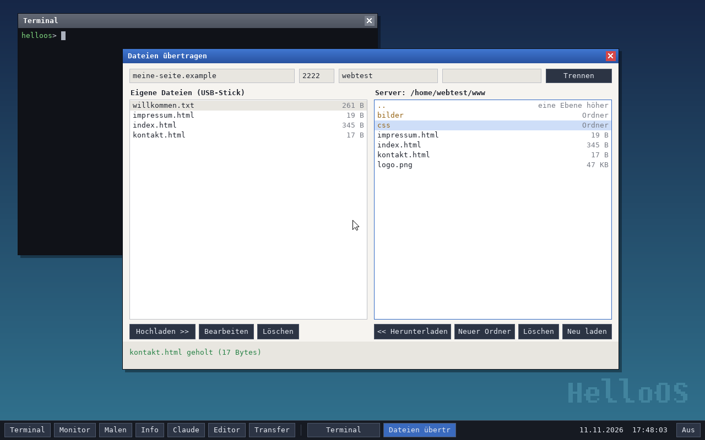

Der Weg einer Änderung an einer Webseite: Datei vom Server holen, im Editor
ändern, wieder hochladen.

### Dateiübertragung (SFTP)

Knopf „Transfer" in der Taskleiste oder F7. Oben Server, Benutzer und Passwort
eintragen (den Port nur, wenn dein Anbieter einen anderen als 22 nennt), dann
„Verbinden". Die Zugangsdaten für **SFTP** stehen bei deinem Webhoster meist
unter „SSH-Zugang" oder „SFTP".

- **Fingerabdruck:** Beim ersten Verbinden zeigt HelloOS den Fingerabdruck
  des Serverschlüssels (`SHA256:…`). Vergleiche ihn mit der Angabe deines
  Anbieters – nur so ist sicher, dass du wirklich mit dessen Server sprichst.
  Nach deinem „Vertrauen" merkt sich HelloOS den Schlüssel auf dem Stick;
  ändert er sich später, erscheint eine deutliche Warnung.
- **Bedienung:** Doppelklick (oder Enter) öffnet einen Ordner auf dem Server
  bzw. holt eine Datei; links öffnet er die Datei im Editor. Hochladen,
  Löschen und neue Ordner gehen über die Knöpfe. Bevor etwas überschrieben
  oder gelöscht wird, fragt HelloOS nach.
- **Passwort:** Es wird nur für die Anmeldung benutzt und nirgends
  gespeichert. Server, Port und Benutzer der letzten Verbindung merkt sich
  HelloOS (Ordner `HELLOOS` auf dem Stick).
- Im Terminal geht dasselbe mit `sftp benutzer@server` und den Befehlen
  `ls`, `cd`, `get`, `put`, `rm`, `mkdir`, `mv` (`hilfe` zeigt alle).

Was unterstützt wird: SFTP über SSH 2 mit den Verfahren aktueller Server
(Schlüsselaustausch curve25519 oder ECDH P-256; Serverschlüssel Ed25519, ECDSA
oder RSA ab 2048 Bit; Verschlüsselung ChaCha20-Poly1305 oder AES-CTR).

Was **nicht** geht:

- **kein FTP und kein FTPS** – nur SFTP. Bietet dein Hoster ausschließlich FTP
  an, kann HelloOS dort nichts übertragen.
- **Anmeldung nur mit Passwort**, nicht mit Schlüsseldatei.
- Nur einzelne Dateien, keine ganzen Ordner auf einmal; Dateien bis 32 MB.
- Auf der eigenen Seite gibt es keine Unterordner. Zwei Dateien gleichen
  Namens aus verschiedenen Server-Ordnern (`index.html`) überschreiben sich
  hier gegenseitig – HelloOS fragt vorher.
- Sehr alte Server, die nur veraltete Verfahren anbieten, werden mit einer
  Meldung abgelehnt, die die angebotenen Verfahren nennt.

### Texteditor

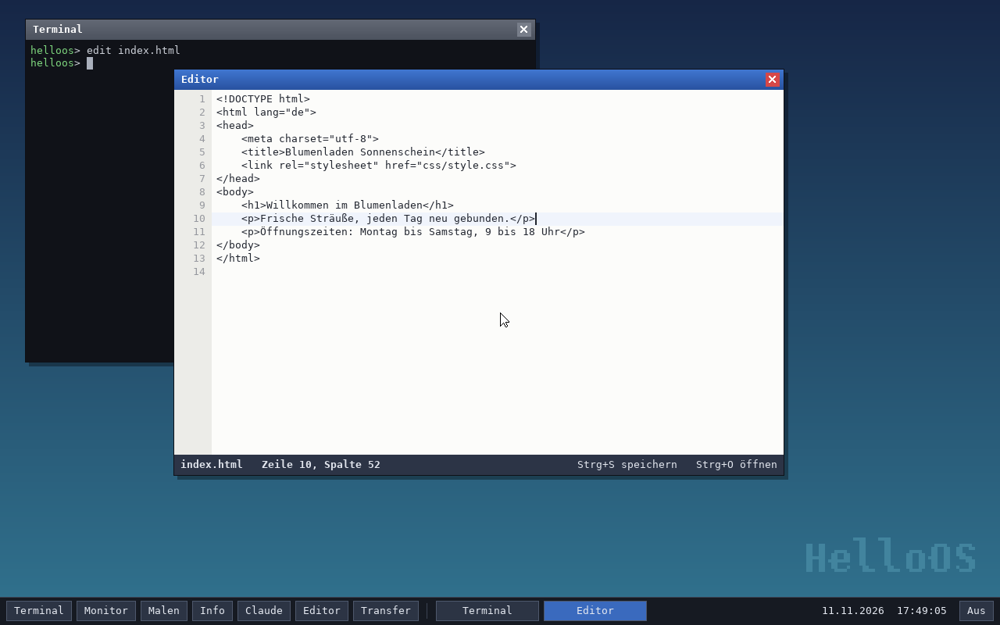

Knopf „Editor", F6 oder `edit <datei>` im Terminal. Ohne Dateinamen erscheint
eine Liste zum Anklicken; ein neuer Name legt eine neue Datei an.

| Taste | Wirkung |
| --- | --- |
| Strg+S | speichern (und auf dem Stick sichern) |
| Strg+O | andere Datei öffnen |
| Pfeile, Pos1, Ende, Bild auf/ab | bewegen; Strg+Pos1 / Strg+Ende: Anfang / Ende der Datei |
| Tab | bis zur nächsten Vierer-Spalte einrücken |
| Alt+F4 oder ✕ | schließen – bei ungesicherten Änderungen mit Rückfrage |

Neue Zeilen übernehmen die Einrückung der vorigen, lange Zeilen werden nicht
umbrochen (der Ausschnitt wandert mit), Windows-Zeilenenden bleiben erhalten.
Es fehlen: Markieren, Kopieren und Einfügen, Suchen, Rückgängig sowie
farbige Hervorhebung. Darstellen kann die Schrift nur lateinische Zeichen.

### Wofür das taugt – und wofür nicht

Die Übertragung selbst ist ordentlich abgesichert: verschlüsselt, mit Prüfung
des Servers, gegen eine Referenzbibliothek und einen echten OpenSSH-Server
getestet. **Trotzdem ist HelloOS kein System für die Arbeit an einem echten
Onlineshop:**

- Getestet ist alles nur in QEMU, nie auf echter Hardware und nur gegen
  OpenSSH – nicht gegen die Server der verschiedenen Webhoster.
- HelloOS hat keinen Speicherschutz; die Kryptografie ist nicht gegen
  Seitenkanäle gehärtet. Für Zugangsdaten zu einem Shop mit Kundendaten ist
  das zu wenig.
- **WordPress lässt sich nur eingeschränkt bedienen.** Der eingebaute Browser
  kennt kein JavaScript; was damit geht und was nicht, steht unter
  [Browser](#wordpress-im-browser-von-helloos).
- Windows-Programme laufen nicht.

Zum Ausprobieren, Lernen und für eine eigene kleine Seite ist es gedacht. Für
den Shop gehört ein ausgereiftes System her – etwa ein Linux vom USB-Stick,
wenn es vom Alltags-Windows getrennt sein soll.

## Internet

Sobald ein Netzwerkkabel steckt, holt sich HelloOS per DHCP eine Adresse.
Danach funktionieren zum Beispiel:

```
ping 10.0.2.2
dns example.com
web https://example.com/
get https://raw.githubusercontent.com/widder92/hello-world/master/README.md readme.md
```

Wichtig zu wissen:

- **HTTPS prüft, mit wem es spricht.** Der TLS-Client kontrolliert die
  Zertifikatskette des Servers gegen 117 eingebaute Wurzelzertifikate (die
  Liste von Mozilla), dazu Servername und Gültigkeitszeitraum. Passt etwas
  nicht, kommt keine Verbindung zustande. Dafür muss die **Uhr des Rechners
  stimmen** – steht sie auf einem Datum weit in der Vergangenheit, gelten alle
  Zertifikate als „noch nicht gültig".
- Unterstützt wird nur TLS 1.3 mit X25519 und ChaCha20-Poly1305. Die meisten
  Server bieten das an, einzelne nicht – dann scheitert der Verbindungsaufbau.
- Wer in einem Netz arbeitet, das HTTPS mit einer eigenen Zertifizierungsstelle
  aufbricht (manche Firmennetze), kann deren Zertifikat beim Bauen mitgeben:
  `make EXTRA_CA=/pfad/zur/ca.pem`.
- Der [Browser](#browser) ist einfach gehalten und kennt kein JavaScript; `web`
  zeigt eine Seite als reinen Text im Terminal.
- Nur IPv4, keine zerteilten Pakete, keine eingehenden Verbindungen.
- In QEMU beantwortet nur der eingebaute Router (`10.0.2.2`) Pings; Pings ins
  Internet leitet QEMUs Netz nicht weiter. Namensauflösung und Webzugriffe
  funktionieren trotzdem.

## Claude

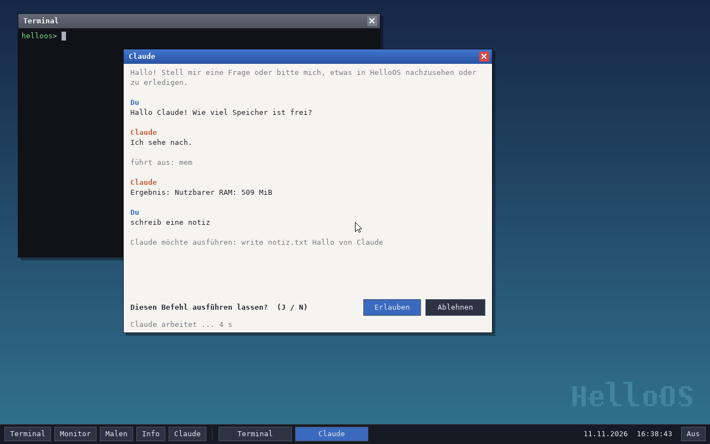

Claude ist in HelloOS eingebaut – als Chatfenster (F5 oder der Knopf „Claude"
in der Taskleiste) und als Befehl im Terminal (`claude wie viel speicher ist
frei?`). Claude beantwortet nicht nur Fragen, sondern kann über die Shell von
HelloOS selbst nachsehen und Dinge erledigen: „Welche Tasks laufen gerade?",
„Lade mir die Seite example.com", „Schreib meine Einkaufsliste in eine Datei".

### Was du dafür brauchst

HelloOS spricht direkt mit der Claude-API von Anthropic. Dafür ist ein
**API-Schlüssel** nötig, den du unter <https://console.anthropic.com/> anlegst.
Die Nutzung wird dort nach Verbrauch abgerechnet – ein Abo von claude.ai
(Pro, Max) deckt das nicht ab und lässt sich hier nicht verwenden.

Den Schlüssel bekommt HelloOS auf einem von drei Wegen:

- als Datei `claude.key` (oder `claude.txt`) im Hauptverzeichnis des
  Datenträgers, von dem HelloOS startet (Stick oder Partition HELLOOS) – einfach den Schlüssel als einzige
  Zeile hineinschreiben; er wird beim ersten Gebrauch gelesen
- im Chatfenster mit `/key sk-ant-...`
- im Terminal mit `claude key sk-ant-...`

Eingetippte Schlüssel gelten bis zum Ausschalten. HelloOS speichert den
Schlüssel nirgends und sendet ihn nur an die API. Wer den Stick hat, hat aber
auch die Datei – behandle ihn entsprechend.

### Was Claude darf

Claude arbeitet mit denselben Befehlen wie du im Terminal, in drei Stufen:

| Stufe | Befehle |
| --- | --- |
| ohne Rückfrage | nur Anzeigen: `info`, `mem`, `uptime`, `date`, `ps`, `ls`, `cat`, `sha256`, `disk`, `news`, `history`, `net` und `keymap` ohne Angaben, außerdem `echo` und `start` |
| erst nach deiner Zustimmung | alles, was etwas verändert oder ins Netz geht: `write`, `append`, `rm`, `edit`, `kill`, `spawn`, `web`, `browse`, `get`, `ping`, `dns`, `update`, `reboot`, `shutdown`, … |
| nie | `panic`, `claude` selbst und `sftp` – Verbindungen zu deinem Server baust nur du auf |

Vor einer Rückfrage steht der vollständige Befehl im Verlauf; im Fenster
bestätigst du mit „Erlauben" oder J, im Terminal mit j. Dass auch reine
Netzzugriffe nachfragen, ist Absicht: Inhalte, die Claude gelesen hat – etwa
eine Webseite mit untergeschobenen Anweisungen –, sollen nichts unbemerkt
nach draußen schicken können.

### Gut zu wissen

- **Was du schreibst und was Befehle ausgeben, geht an Anthropic.** Dazu gehört
  auch der Inhalt von Dateien, die Claude mit `cat` liest.
- Antworten erscheinen am Stück, nicht Wort für Wort; bei längeren Aufgaben
  kann das eine Weile dauern. Die Statuszeile zeigt, dass Claude arbeitet.
- Das Fenster zeigt reinen Text. Zeichen außerhalb des lateinischen Alphabets
  (auch Emojis) erscheinen als „?".
- Ein Gespräch lebt im Arbeitsspeicher, bis das Fenster geschlossen wird;
  `/neu` (im Terminal `claude neu`) beginnt ein neues. Die Terminals teilen
  sich ein Gespräch, getrennt von dem im Chatfenster.
- Voreingestellt ist das Modell `claude-opus-5-5` mit Gründlichkeit `low`
  (schnelle, kurze Antworten). Ändern mit `claude modell <name>` und
  `claude effort <low|medium|high|xhigh|max>`.
- Lehnt das Modell eine Anfrage ab, darf die API sie von einem anderen
  Claude-Modell beantworten lassen (Anthropics serverseitiger Rückfall).
- Die API-Adresse lässt sich beim Bauen ändern (`make CLAUDE_API_URL=...`),
  etwa für ein eigenes Gateway.

**Stand der Erprobung:** Die Anbindung ist gegen einen nachgebauten API-Server
getestet (Antworten, Befehlsaufrufe mit und ohne Rückfrage, Ablehnungen,
Fehler und Wiederholungen) sowie gegen die echte Adresse `api.anthropic.com`
mit einem ungültigen Schlüssel, was erwartungsgemäß die Fehlermeldung der API
liefert. Ein vollständiges Gespräch mit einem echten Schlüssel wurde noch
nicht geführt. Die Antworten im Bild oben stammen vom Testserver.

## Updates

HelloOS hält sich auf Wunsch selbst aktuell – installiert aber nichts, ohne
zu fragen.

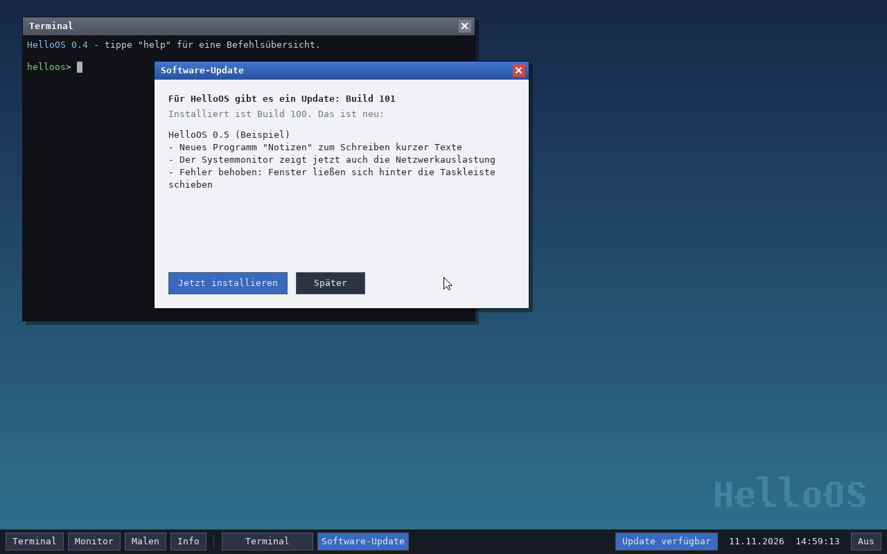

1. **Prüfen.** Etwa fünf Sekunden nach dem Netzwerkstart und danach alle sechs
   Stunden wird von der Update-Quelle `helloos.version` geladen. Steht dort
   eine größere Build-Nummer als die eigene, folgt das Paket `helloos.upd`.
   Es wird nur akzeptiert, wenn seine **Ed25519-Signatur** zum öffentlichen
   Schlüssel passt, der in den Kernel eingebaut ist, und wenn die mitsignierte
   Build-Nummer wirklich neuer ist.
2. **Fragen.** Ein Fenster zeigt, was die neue Version bringt, und bietet
   „Jetzt installieren" und „Später" an. Wer „Später" wählt, wird für diese
   Version nicht noch einmal von selbst gefragt; in der Taskleiste bleibt der
   Knopf „Update verfügbar" stehen, bis das Update installiert ist. Im
   Terminal fragt der Befehl `update` mit „(j/n)".
3. **Installieren.** Auf dem Datenträger, von dem HelloOS gestartet wurde, wird
   `EFI/BOOT/BOOTX64.EFI` ausgetauscht – zuerst wird die neue Datei komplett
   geschrieben, dann mit einem einzigen Schreibzugriff umgeschaltet. Ein
   Stromausfall mittendrin hinterlässt also die alte oder die neue Version,
   aber keine halbe. Aktiv wird das Update beim nächsten Start; das Fenster
   bietet den Neustart gleich an.

Über die Echtheit eines Updates entscheidet allein diese Signatur, nicht der
Server, von dem es kommt: Ohne den geheimen Schlüssel kann niemand ein Paket
herstellen, das HelloOS annimmt.

### Woher neue Funktionen kommen

Ein Update enthält genau das, was im Repository entwickelt und veröffentlicht
wurde – von allein entstehen keine neuen Funktionen. Der Weg einer Neuerung:

1. Die Änderung wird unter `os/` entwickelt.
2. In `os/NEUES.txt` steht in ein paar Zeilen, was sich für Benutzer ändert.
   Dieser Text erscheint im Update-Fenster und unter `news`.
3. Sobald die Änderung auf dem Zweig `master` landet, baut der Workflow ein
   signiertes Paket und veröffentlicht es. Laufende Installationen finden es
   bei ihrer nächsten Prüfung und fragen nach.

### Einrichten

**Ohne Schlüssel sind Updates abgeschaltet** – so wird HelloOS standardmäßig
gebaut, und dann fragt es auch nirgends nach neuen Versionen. So schaltest du
sie ein:

1. Schlüsselpaar erzeugen: `make update-key`. Das legt zwei Dateien an:
   - `update-key.pub` – der öffentliche Teil. Einchecken; er wird beim Bauen
     in den Kernel übernommen.
   - `update-key.private` – der geheime Teil. **Niemals einchecken oder
     weitergeben** (`.gitignore` schließt ihn aus). Wer ihn hat, kann Updates
     für deine Installationen ausstellen; geht er verloren, lassen sich
     bestehende Installationen nicht mehr aktualisieren.
2. Den Inhalt von `update-key.private` bei GitHub als Repository-Secret
   `HELLOOS_UPDATE_KEY` hinterlegen (Settings → Secrets and variables → Actions).
3. HelloOS neu bauen und auf den Stick bringen – erst diese Version kennt den
   Schlüssel.

In diesem Repository ist Schritt 1 erledigt: `update-key.pub` ist eingecheckt,
jede hier gebaute Version kennt also den Schlüssel. Der geheime Teil gehört
als Secret zu GitHub (Schritt 2) und sonst nur an einen sicheren Ort beim
Besitzer des Repositorys.

Von da an baut der Workflow `.github/workflows/helloos-update.yml` bei jeder
Änderung unter `os/` auf dem Zweig `master` ein signiertes Paket und legt es
auf den Branch `helloos-updates`. Dort sucht HelloOS standardmäßig
(`UPDATE_URL` im `Makefile`). Geprüft ist dieser Weg einmal von Anfang bis
Ende: Der Workflow hat Build 21 veröffentlicht, und ein älteres HelloOS in
QEMU hat das Paket von GitHub geholt, geprüft, installiert und danach in der
neuen Version gestartet. Auch auf einem echten PC hat ein Update über das Netzwerk funktioniert (von Build 26 auf 27, vom USB-Stick gestartet). GitHub liefert die Build-Nummer bis zu fünf Minuten aus einem Zwischenspeicher – direkt nach einer Veröffentlichung meldet `update` deshalb unter Umständen noch „ist aktuell".

Es geht auch von Hand: `make update-package` erzeugt
`build/update/helloos.upd` (samt dem Text aus `NEUES.txt`) und
`helloos.version`; beide Dateien müssen dann unter der Adresse erreichbar
sein, die beim Bauen als `UPDATE_URL` galt.

Die Build-Nummer ist die Anzahl der Commits (`git rev-list --count HEAD`).
Updates brauchen einen Datenträger, den HelloOS beschreiben kann: den
USB-Stick oder die eigene Partition auf einer
internen NVMe- oder SATA-Platte.

## Wie es funktioniert

### Start

1. Die UEFI-Firmware lädt `EFI/BOOT/BOOTX64.EFI` und ruft `efi_main()` in
   `kernel/boot.c` auf – der Prozessor ist da schon im 64-Bit-Modus.
2. `efi_main()` holt sich von der Firmware den Bildspeicher (GOP), die
   Speicherkarte und die Uhrzeit und misst die Frequenz des Zeitstempelzählers.
3. Mit `ExitBootServices()` wird die Firmware verabschiedet. Ab hier gehört
   die Maschine dem Kernel: eigene Seitentabellen (der gesamte RAM 1:1
   abgebildet), eigener Stack, weiter nach `kmain()` in `kernel/main.c`.
4. `kmain()` richtet Interrupts, Speicher, Bildschirm, Systemtakt, Eingabe-
   geräte und Netzwerk ein, startet die ersten Tasks und wird zum Leerlauf-Task.

### Kernel

- **Systemtakt:** Der Timer des Local APIC unterbricht 1000-mal pro Sekunde.
  Dabei werden PS/2-Controller und serielle Schnittstelle abgefragt und der
  Scheduler aufgerufen. Es ist der einzige Interrupt, den HelloOS braucht –
  das macht den Kernel unabhängig davon, wie ein Rechner seine
  Interrupt-Leitungen verdrahtet. USB und Netzwerk haben eigene Tasks, die
  ihre Geräte regelmäßig abfragen.
- **Multitasking:** Kernel-Threads mit eigenem Stack (`kernel/task.c`). Tasks,
  die gerade aus dem Warten aufwachen (Eingaben, Oberfläche), kommen vor
  solchen dran, die nur rechnen – so bleibt die Oberfläche auch unter Last
  bedienbar.
- **Speicher:** Heap im größten freien Bereich laut Firmware, dazu ein Vorrat
  ganzer Seiten unterhalb von 4 GiB für Gerätetreiber (`kernel/memory.c`).
- **USB:** Für jeden xHCI-Controller läuft ein Task, der Anschlüsse
  beobachtet, neue Geräte einrichtet, Berichte von Tastatur und Maus auswertet
  und Lese-/Schreibaufträge für USB-Sticks ausführt (`kernel/usb.c`).
- **Netzwerk:** Der Task „netz" holt Pakete von der Karte und reicht sie durch
  die Schichten (`kernel/net.c`, `kernel/tcp.c`). Programme rufen blockierende
  Funktionen wie `tcp_connect()` auf und werden geweckt, wenn etwas ankommt.

### Oberfläche

Jedes Programm ist ein Task mit einem Fenster. Es zeichnet in eine eigene
Pixelfläche und meldet geänderte Bereiche; auf Eingaben wartet es in einer
Ereignisschleife. Ein weiterer Task, der Compositor (`kernel/gui.c`), setzt
aus Hintergrund, Fenstern, Taskleiste und Mauszeiger das Bild zusammen – immer
nur für die Bereiche, die sich geändert haben – und kopiert das Ergebnis in den
Bildspeicher. Er verteilt außerdem Tastatur und Maus an die Fenster.

## Aufbau des Quellcodes

| Datei | Aufgabe |
| --- | --- |
| `kernel/boot.c`, `kernel/efi.h` | Start über UEFI, Übergabe an den Kernel |
| `kernel/main.c` | Initialisierung, Leerlauf |
| `kernel/lowlevel.asm` | Interrupt-Einsprünge, Task-Wechsel |
| `kernel/interrupts.c` | GDT, IDT, Ausnahmen, Local APIC, Systemtakt |
| `kernel/time.c` | Zeitmessung, Datum und Uhrzeit |
| `kernel/memory.c`, `kernel/heap.c` | Seitenvergabe, Seitentabellen; der Heap (Listen freier Blöcke nach Größe) |
| `kernel/task.c` | Tasks und Scheduler |
| `kernel/console.c`, `kernel/serial.c` | Konsolen, `kprintf`, serielle Schnittstelle |
| `kernel/keyboard.c`, `kernel/ps2.c` | Tastaturbelegungen, PS/2-Tastatur und -Maus |
| `kernel/pci.c`, `kernel/usb.c`, `kernel/hid.c` | PCI-Bus, xHCI-Treiber (Hubs, Tastatur, Maus, Massenspeicher), Auswertung der HID-Berichte |
| `kernel/nvme.c`, `kernel/ahci.c` | interne Datenträger: NVMe-SSDs und SATA-Platten |
| `kernel/install.c` | Start-Assistent: Einrichten auf der internen Platte über die Firmware |
| `kernel/block.c`, `kernel/fat.c` | Blockgeräte samt Schreibsperre für interne Platten, FAT32 |
| `kernel/fs.c`, `kernel/storage.c` | eigene Dateien im Arbeitsspeicher; Sicherung auf dem HelloOS-Datenträger |
| `kernel/e1000.c`, `kernel/igc.c` | Treiber für Intel-Netzwerkkarten: e1000-Familie; I225/I226 und Verwandte |
| `kernel/net.c`, `kernel/tcp.c` | ARP, IPv4, ICMP, UDP, DHCP, DNS; TCP |
| `kernel/crypto_*.c` | SHA-2, HMAC/HKDF, ChaCha20-Poly1305, AES-CTR, X25519, Ed25519, RSA, ECDSA, ECDH |
| `kernel/x509.c`, `kernel/tls_roots.*` | Zertifikate lesen und prüfen, eingebaute Wurzelzertifikate |
| `kernel/tls.c`, `kernel/http.c`, `kernel/url.c` | TLS 1.3, HTTP-Client, Web-Adressen |
| `kernel/layout.c` | der Seitenaufbau mit Kastenmodell: aus dem Abbild der Seite und ihren Stylesheets werden Kästen, Zeilen, Bilder und Felder mit ihrer Lage; auf Wunsch hält er fest, wo jedes Element steht (für Skripte) |
| `kernel/html.c`, `kernel/browser.c` | die einfache Darstellung im Zeilenraster (und was beide Seitenaufbauten teilen); das Browser-Fenster |
| `kernel/css.c` | Stylesheets lesen und auf Elemente anwenden; die Grundregeln des Browsers |
| `kernel/js_*.c`, `kernel/js.h`, `kernel/jslib.js` | die JavaScript-Maschine: Quelltext lesen (`js_parse.c`), ausführen (`js_run.c`), Werte und Speicherbereinigung (`js_core.c`), Zahlen (`js_num.c`), eingebaute Objekte (`js_lib*.c` und – in JavaScript selbst geschrieben – `jslib.js`), Symbole und Iteratoren (`js_sym.c`), `Map`/`Set` (`js_coll.c`), Generatoren und `async` (`js_co.c`), `Proxy`/`Reflect` (`js_proxy.c`), Module (`js_module.c`), reguläre Ausdrücke (`js_regex.c`), typisierte Felder (`js_typed.c`) |
| `kernel/dom.c` | das veränderbare Abbild einer Seite (DOM): Baum lesen, umbauen, wieder zu Quelltext machen |
| `kernel/dom_js.c`, `kernel/domlib.js`, `kernel/script.h` | Skripte einer Seite: Verbindung von Abbild und JavaScript-Maschine; `window`, `document` und die Elemente, zum großen Teil selbst in JavaScript geschrieben |
| `kernel/image*.c`, `kernel/inflate.c` | Bilder entschlüsseln (PNG, JPEG, GIF) und verkleinern |
| `kernel/ssh.c`, `kernel/sftp.c` | SSH-Client, Dateiübertragung per SFTP |
| `kernel/json.c` | JSON lesen und schreiben |
| `kernel/claude.c`, `kernel/claude_app.c` | Anbindung an die Claude-API, Chatfenster |
| `kernel/update.c` | Selbstaktualisierung |
| `kernel/gfx.c`, `kernel/font_data.c` | Zeichenfunktionen, Rasterschrift (Terminal, Editor, Eingabefelder) |
| `kernel/truetype.c`, `kernel/font.c`, `fonts/` | TrueType-Renderer, Schriftverwaltung mit Zwischenspeicher, die eingebauten Schriftdateien (DejaVu Sans, Lizenz liegt bei) |
| `kernel/gui.c` | Compositor, Fensterverwaltung, Taskleiste, Startmenü |
| `kernel/terminal.c`, `kernel/shell.c` | Terminalfenster und Kommandozeile |
| `kernel/editor.c`, `kernel/textedit.c`, `kernel/transfer.c` | Texteditor und sein Textfeld, Fenster zur Dateiübertragung |
| `kernel/sound.c` | Ton: Treiber für Intel HD Audio, Mischer, errechnete Systemklänge |
| `kernel/sysmon.c`, `kernel/paint.c`, `kernel/about.c` | Systemmonitor, Malprogramm, Dialoge |
| `tools/mkimage.py` | baut das Disk-Image (GPT, FAT32) |
| `tools/update-tool.py` | Schlüssel erzeugen, Update-Pakete signieren und prüfen |
| `tools/mkfont.py` | erzeugt `font_data.c` aus einer TrueType-Schrift |
| `tools/mkroots.py` | erzeugt `tls_roots.bin` aus einer Liste von Wurzelzertifikaten |
| `tools/embed.py` | bettet `domlib.js` als Zeichenfeld in den Kernel ein |
| `tools/smoke-test.sh` | automatischer Boot-Test in QEMU |
| `tests/crypto_test.py` | Kryptografie gegen `hashlib` und `cryptography` prüfen |
| `tests/web_test.c` | Web-Adressen und Seitenaufbau prüfen (Text, Tabellen, Kästen neben dem Text, Spalten und Raster, HTML5), auch mit beschädigten Seiten |
| `tests/block_test.c` | Schreibsperre für interne Platten prüfen |
| `tests/heap_test.c` | Kernel-Heap prüfen: zufälliges Anfordern und Freigeben, Verkettungen, voller Speicher |
| `tests/js_test.c`, `tests/js/*.js`, `tests/js_oracle.js` | JavaScript-Maschine prüfen (auch mit ständiger Speicherbereinigung und mit verstümmelten Skripten); die Erwartungen prüft Node.js gegen, wenn es installiert ist |
| `tests/dom_test.c` | Seitenabbild prüfen: lesen, umbauen, Quelltext erzeugen, beschädigte Seiten |
| `tests/script_test.c` | Skripte von Webseiten prüfen: Abbild, Ereignisse, Laden, Zeitgeber, Nachladen, Maße und Lage (mit dem echten Seitenaufbau), Rollen, Beobachter, Fenstergröße, Maus und Fokus, beobachtete Änderungen (MutationObserver), Grenzen, beschädigte Seiten |
| `tests/hid_test.c` | Auswertung der HID-Berichte prüfen (Mäuse, Tastaturen, Funkempfänger) |
| `tests/image_test.c`, `tests/image_test.py` | Bild-Dekoder gegen eine Referenz prüfen, auch mit beschädigten Dateien |
| `tests/css_test.c` | Stylesheets prüfen: Auswahlen (nach Attributen, Geschwistern, Stellung und Zuständen - auch Maus und Fokus; `:not`, `:is`), Rangfolge, Farben, Variablen, `@media`, Breiten, Abstände, Rahmen, Raster, Längen mit `calc()`, beschädigte Eingaben |
| `tests/layout_test.c` | den Seitenaufbau mit Kastenmodell prüfen: kleine Seiten setzen und nachmessen, wo Kästen und Zeilen stehen (auch die Lage der Elemente, wie Skripte sie erfahren, und was am Fenster haftet); dazu tausende beschädigte Seiten |
| `tests/layout_view.c` | Werkzeug: setzt eine HTML-Datei auf dem Entwicklungsrechner und schreibt sie als Bild |
| `tests/http_test.c` | den HTTP-Client prüfen, mit einem ausgedachten Netz: Anfragen, Antworten, Weiterleitungen, die Sperre fürs Heimnetz |
| `tests/font_test.c`, `tests/font_test.py` | Schriftrenderer Zeichen für Zeichen gegen FreeType prüfen, auch mit beschädigten Schriftdateien |

## Grenzen und Ideen zum Weiterbauen

HelloOS ist ein Lernsystem. Alles läuft im Kernel-Modus in einem gemeinsamen
Adressraum; es gibt keinen Speicherschutz und keine Programme von außerhalb
(auch keine Windows-Programme). Die Kryptografie ist geprüft,
aber nicht gegen Seitenkanäle gehärtet, und der Zufallsgenerator ist einfach
gehalten. Naheliegende nächste Schritte:

- Claudes Antworten Wort für Wort anzeigen (Streaming), Gespräche speichern
- Unterordner für eigene Dateien, ganze Ordner übertragen, Anmeldung mit Schlüsseldatei
- im Editor: Markieren, Kopieren und Einfügen, Suchen, Rückgängig
- weitere Netzwerkkarten (Realtek), WLAN
- User-Modus (Ring 3) mit Systemaufrufen und getrennten Adressräumen
- Programme aus Dateien laden (ELF), mehrere Prozessorkerne
- Symbole auf dem Desktop, ein Dateimanager, Fenster an den Kanten ziehen und minimieren
- im Browser: Rollbereiche in der Seite (`overflow: auto`), Schatten, Durchsichtigkeit ganzer Elemente, Bewegung; WebP- und SVG-Bilder; Tabs
- JavaScript: Zeichenflächen (Canvas); Ziehen mit der Maus; eine Schutzwand zwischen Skripten und System (dafür braucht es den User-Modus)
- echte Schrift auch in Terminal, Editor und Eingabefeldern; Hinting für schärfere kleine Schrift

## Die ältere 32-Bit-Version

In [`legacy-bios32/`](legacy-bios32/) liegt die erste Fassung von HelloOS: ein
32-Bit-System mit eigenem BIOS-Bootloader und Textoberfläche. Sie läuft auf
PCs mit klassischem BIOS (oder CSM), nicht aber auf reinen UEFI-Rechnern, und
hat weder Netzwerk noch Updates.

## Schrift

Die Schrift der Oberfläche ist eine gerasterte Fassung von DejaVu Sans Mono
(freie Lizenz, siehe Kopf von `kernel/font_data.c`). Alles andere in diesem
Verzeichnis ist für HelloOS geschrieben.
