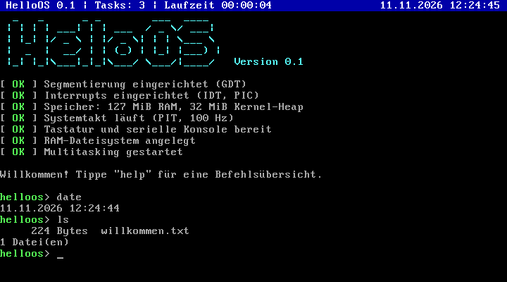

# HelloOS (32 Bit, BIOS)

> Dies ist die erste Fassung von HelloOS. Die aktuelle 64-Bit-Version mit
> grafischer Oberfläche liegt eine Ebene höher – siehe [../README.md](../README.md).

Ein kleines, von Grund auf selbst geschriebenes Betriebssystem für x86-PCs
(32 Bit). Kein Linux, kein GRUB, keine fremde Bibliothek: Bootloader in
Assembler, Kernel in C, zusammen knapp 3000 Zeilen.



## Was es kann

- **Eigener Bootloader** (512 Bytes): lädt den Kernel per BIOS von Diskette
  oder Festplatte, fragt die Speicherkarte ab, schaltet in den Protected Mode
- **Interrupts**: eigene GDT und IDT, Behandlung aller CPU-Ausnahmen mit
  Kernel-Panic-Anzeige, Hardware-Interrupts über den PIC
- **Treiber**: VGA-Textmodus, PS/2-Tastatur (deutsche und US-Belegung inkl.
  Umlauten und AltGr), Systemtimer (PIT), Echtzeituhr, serielle Schnittstelle
- **Speicherverwaltung**: Kernel-Heap (`kmalloc`/`kfree`) im größten freien
  Bereich laut BIOS-Speicherkarte
- **Präemptives Multitasking**: Kernel-Threads mit Round-Robin-Scheduler,
  `sleep`, blockierendes Warten auf Eingaben, Leerlauf-Task
- **RAM-Dateisystem**: Dateien anlegen, anhängen, anzeigen, löschen
- **Shell** mit 20 Befehlen, Befehlsverlauf und Statusleiste

## Bauen und starten

Benötigt werden `gcc` (mit 32-Bit-Unterstützung), `binutils`, `nasm`, `make`
und zum Ausprobieren `qemu-system-i386`. Unter Debian/Ubuntu:

```sh
sudo apt install build-essential nasm qemu-system-x86
```

Dann in diesem Verzeichnis:

```sh
make            # baut build/helloos.img
make run        # startet HelloOS in einem QEMU-Fenster
make run-tty    # startet es direkt im Terminal (serielle Konsole)
make test       # bootet ohne Bildschirm und prüft die wichtigsten Befehle
```

Auf macOS oder anderen Systemen ohne passenden `gcc` funktioniert ein
Cross-Compiler:
`make CC=i686-elf-gcc LD=i686-elf-ld OBJCOPY=i686-elf-objcopy`.

Das Image ist ein rohes Disk-Image in Diskettengröße. Es startet auch in
VirtualBox oder Bochs und – auf einen USB-Stick geschrieben – auf PCs mit
klassischem BIOS-Boot (nicht reines UEFI). Auf echter Hardware wurde es
bisher nicht getestet.

## Befehle

| Befehl | Wirkung |
| --- | --- |
| `help` | Befehlsübersicht |
| `info` | System, Prozessor, Speicher |
| `mem` | Heap-Belegung und Speicherkarte des BIOS |
| `uptime`, `date` | Laufzeit bzw. Datum und Uhrzeit |
| `ps` | Tasks mit Zustand und verbrauchter CPU-Zeit |
| `spawn counter [n]` | Hintergrund-Task, der im Sekundentakt bis *n* zählt |
| `spawn burn` | Hintergrund-Task, der pausenlos rechnet (zeigt die Präemption) |
| `kill <pid>` | Task beenden |
| `ls`, `cat <datei>`, `rm <datei>` | Dateien auflisten, anzeigen, löschen |
| `write <datei> <text>` | Datei (über)schreiben |
| `append <datei> <text>` | Zeile anhängen |
| `echo <text>` | Text ausgeben |
| `keymap [de\|us]` | Tastaturbelegung anzeigen oder umschalten (Standard: `de`) |
| `history`, `clear` | Befehlsverlauf, Bildschirm löschen |
| `panic` | löst absichtlich eine CPU-Ausnahme aus |
| `reboot`, `shutdown` | Neustart, Herunterfahren |

Pfeil hoch/runter blättert im Verlauf, Strg+C verwirft die Eingabe,
Strg+L löscht den Bildschirm.

## So startet das System

1. Das BIOS lädt den ersten Sektor des Datenträgers (`boot/boot.asm`) nach
   `0x7C00` und führt ihn im 16-Bit Real Mode aus.
2. Der Bootsektor liest den Kernel Sektor für Sektor nach `0x10000`, holt die
   Speicherkarte (int 15h, E820), schaltet die A20-Leitung ein und wechselt
   in den 32-Bit Protected Mode.
3. `kernel/entry.asm` setzt den Stack, nullt den BSS-Bereich und ruft
   `kmain()` in `kernel/main.c` auf.
4. `kmain()` richtet GDT, IDT, Speicher, Timer, Tastatur und Dateisystem ein,
   startet die Tasks `shell` und `statusleiste` und wird selbst zum
   Leerlauf-Task.

Ab dann unterbricht der Timer 100-mal pro Sekunde den laufenden Task; der
Scheduler in `kernel/task.c` sucht den nächsten lauffähigen Task und
`kernel/switch.asm` tauscht die Stacks.

### Speicheraufteilung

| Adresse | Inhalt |
| --- | --- |
| `0x07C00` | Bootsektor |
| `0x08000` | Speicherkarte vom BIOS (Anzahl + Einträge) |
| `0x10000` | Kernel (Code, Daten, BSS) |
| bis `0x80000` | Stack des Start-/Leerlauf-Tasks (wächst nach unten) |
| `0xB8000` | VGA-Textspeicher |
| ab `0x100000` | Kernel-Heap (bis 32 MiB): Task-Stacks, Dateiinhalte |

## Aufbau des Quellcodes

| Datei | Aufgabe |
| --- | --- |
| `boot/boot.asm` | Bootsektor |
| `kernel/entry.asm` | Einstieg in den Kernel |
| `kernel/main.c` | Initialisierung, Statusleiste, Leerlauf |
| `kernel/gdt.c`, `kernel/idt.c`, `kernel/interrupts.asm` | Segmentierung, Ausnahmen, IRQs |
| `kernel/timer.c`, `kernel/rtc.c` | Systemtakt, Echtzeituhr |
| `kernel/keyboard.c`, `kernel/serial.c` | Eingabe (Tastatur, serielle Konsole) |
| `kernel/vga.c`, `kernel/console.c` | Bildschirm, `kprintf` |
| `kernel/memory.c` | Speicherkarte und Heap |
| `kernel/task.c`, `kernel/switch.asm` | Tasks und Scheduler |
| `kernel/fs.c` | RAM-Dateisystem |
| `kernel/shell.c` | Kommandozeile |
| `kernel/string.c` | `memcpy`, `strlen` & Co. |
| `tools/smoke-test.sh` | automatischer Boot-Test in QEMU |

## Grenzen und Ideen zum Weiterbauen

HelloOS ist ein Lernsystem. Alles läuft im Kernel-Modus in einem gemeinsamen
Adressraum, es gibt weder Speicherschutz noch Programme von außerhalb, und
Dateien überleben keinen Neustart. Naheliegende nächste Schritte:

- Paging und getrennte Adressräume
- User-Modus (Ring 3) mit Systemaufrufen
- Programme aus Dateien laden (ELF)
- ein Dateisystem auf der Platte (z. B. FAT12) mit ATA- oder Diskettentreiber
- Cursor-Tasten und Tab-Vervollständigung in der Shell
